<div align="center">

# ◎ Ripple

### Turn the BRB screen into the best part of the stream.

**A Twitch evolution game where chat evolves a living creature and raids carry its descendants into new communities.**<br>
And when the streamer steps away, the break becomes a studio:<br>
viewers mold the creature's next shell with their **real hand movements**, tracked live through an ordinary webcam.

[](https://ripple-oze8.onrender.com/)
[](https://twitchcon-codex.devpost.com/)

[](#how-codex-was-used)
[](https://ai.google.dev/edge/mediapipe)
[](compose.yaml)

**[Try the live demo](https://ripple-oze8.onrender.com/)** &nbsp;·&nbsp;
**[The problem](#the-problem-dead-air)** &nbsp;·&nbsp;
**[Cocoon Studio](#cocoon-studio-sculpt-it-with-your-hands)** &nbsp;·&nbsp;
**[How it plays](#how-it-plays)** &nbsp;·&nbsp;
**[Architecture](#architecture)** &nbsp;·&nbsp;
**[Run it locally](#run-it-locally)** &nbsp;·&nbsp;
**[Judge guide](docs/judge-guide.md)** &nbsp;·&nbsp;
**[Hackathon entry](#built-for-the-codex--twitchcon-hackathon)**

<br>

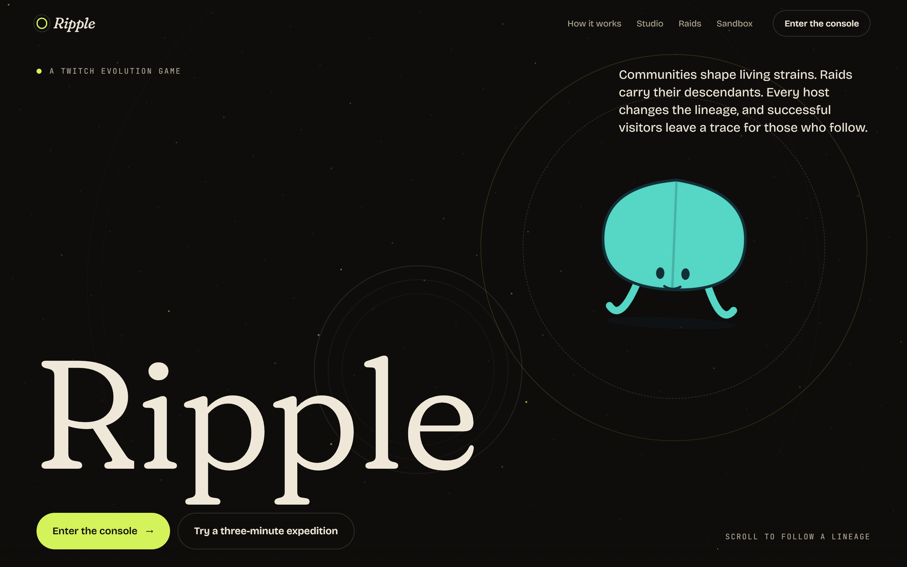

</div>

> [!NOTE]
> **Built for the [Codex × TwitchCon Hackathon](https://twitchcon-codex.devpost.com/)** (23 October to 2 November 2026): an interactive experience for streamers and their communities that connects to Twitch through chat, EventSub, the Twitch API and an OBS overlay, built with OpenAI Codex. **Try it now at [ripple-oze8.onrender.com](https://ripple-oze8.onrender.com/)**: the whole game loop runs in your browser in about three minutes, with no install, Twitch account or camera required. See [what the demo includes](#live-demo) and [the hackathon section](#built-for-the-codex--twitchcon-hackathon).

## At a glance

Every stream has dead air. The streamer steps away for food, a call or a stretch, the channel sits on a _Be right back_ card, chat goes quiet and viewers drift off. **Ripple gives those minutes a job.** It is an evolution game that lives on the stream: chat evolves a creature, the channel's real activity decides whether it thrives, raids carry its descendants to other communities, and the moment the streamer switches to their break scene, a studio opens where viewers reshape the creature with their own hands in front of a webcam.

| **01 · Vote**                                                                                                 | **02 · Survive**                                                                                                    | **03 · Sculpt**                                                                                                                                | **04 · Travel**                                                                                                                                |
| :------------------------------------------------------------------------------------------------------------ | :------------------------------------------------------------------------------------------------------------------ | :--------------------------------------------------------------------------------------------------------------------------------------------- | :--------------------------------------------------------------------------------------------------------------------------------------------- |
| Chat picks one of three genetic mutations with `!ripple 1`, `2` or `3`. One account, one vote, no pay-to-win. | The stream is the habitat. Chat's burst and steadiness score the creature's fitness and move its energy up or down. | On a break, Cocoon Studio opens. Viewers pinch, pull and stretch the creature's shell with in-browser hand tracking, then chat picks a winner. | A real raid sends one descendant to the destination channel, carrying its genes, its community-made shell and a passport of where it has been. |

## The problem: dead air

**The quietest minutes of a stream can be its most creative ones.**

When a streamer goes AFK, the usual options are a static BRB card, a looping clip or a countdown. Viewers have nothing to do, so they leave, and the stream comes back to a thinner chat. Ripple flips that around. Switching to a configured break scene in OBS opens **Cocoon Studio** automatically, and the game clock pauses at its checkpoint. While the streamer is away, viewers turn on their camera, pinch the creature's shell and pull it into a new shape. When creation closes, chat votes between the finalists and **Keep current**, the streamer approves the winner, and the new shell hatches at the next mutation. From then on it travels with every descendant the creature sends out on a raid.

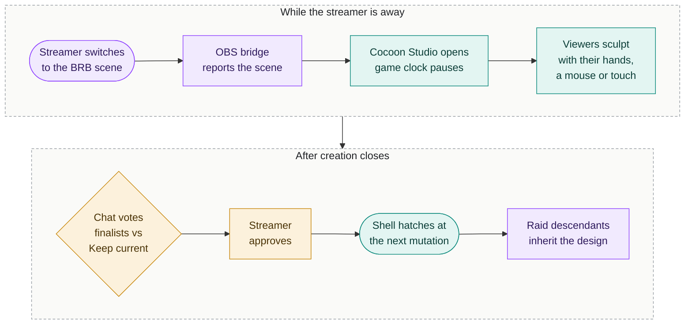

No OBS bridge? The broadcaster can open the studio with one click from the console instead.

The moment the break starts, the overlay swaps the round for an invitation: a link to the studio, the legal trade-offs and a countdown to the vote.

<p align="center">
  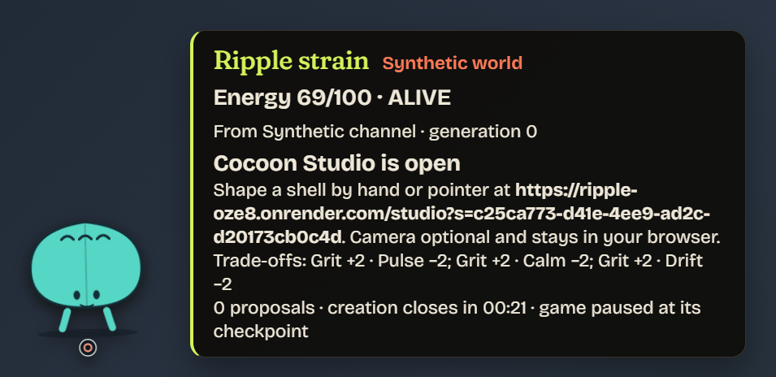
</p>

|                                                         | A static BRB screen |                       **Ripple's break studio**                        |
| :------------------------------------------------------ | :-----------------: | :--------------------------------------------------------------------: |
| Viewers have something to do while the streamer is away |          ✕          |                       ✓ sculpt, propose and vote                       |
| What they make outlasts the break                       |          ✕          |            ✓ the winning shell joins the creature for good             |
| It follows the community to other channels              |          ✕          |      ✓ raid descendants inherit it and credit where it came from       |
| The streamer stays in control                           |          ✓          | ✓ approve the winner, keep the current shell, or turn on auto-approval |
| Anyone can join, with or without a camera               |          ✓          |  ✓ pointer, touch and keyboard get the same choices and the same vote  |
| It starts on its own                                    |          ✓          |           ✓ from a configured OBS break scene, or one click            |

## Cocoon Studio: sculpt it with your hands

This is the heart of Ripple. Google's **MediaPipe Hand Landmarker** runs inside the viewer's own browser, in a Web Worker, and follows 21 points on each hand from an ordinary webcam. Your index fingertip becomes a cursor over the creature, and pinching your thumb and index finger together grabs its shell. There is nothing to install, no GPU server and no video upload: the creature changes shape in real time as your hand moves.

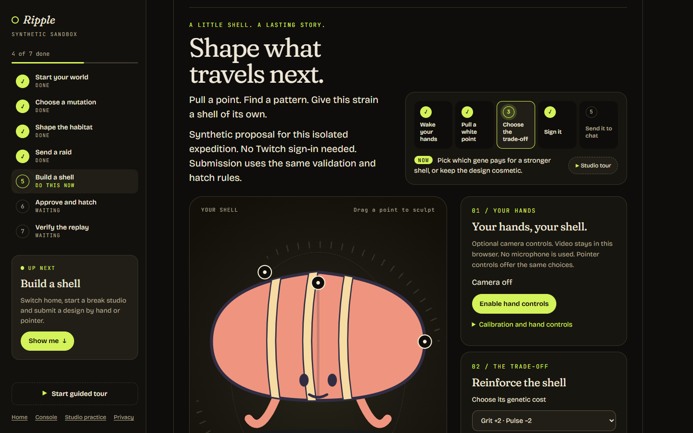

### Gestures

| Gesture                                             | What it does                                                             |
| :-------------------------------------------------- | :----------------------------------------------------------------------- |
| **Point** with your index finger                    | Moves the hand cursor over the shell                                     |
| **Pinch** thumb and index finger over a white point | Grabs that control point: the shell's width, its height or its curvature |
| **Move while pinching**                             | Reshapes the shell live, always inside its bounds                        |
| **Release**                                         | Lets go. Each pinch-and-move is one step you can undo                    |
| **Pinch with both hands and pull apart**            | Scales the whole shell (turn off one-hand mode first)                    |
| **Hand leaves the frame**                           | Editing freezes until tracking returns. Nothing is saved or submitted    |

A short calibration panel offers a mirrored camera preview, a live hand-detection status, a pinch demonstration, a sensitivity slider (0.5 to 1.5), one-hand mode (on by default), and undo, redo and reset.

### From webcam to shell

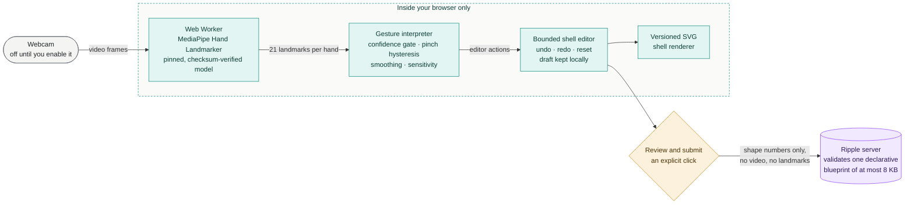

The interpreter only trusts a hand it is confident about (at least 0.7, with all 21 landmarks inside the frame). Grabbing a point takes a tighter pinch than holding it, so a grip does not flicker loose mid-drag, and the fingertip is smoothed to steady small tremors.

### What you shape, and what Ripple enforces

| You shape, with hands, pointer, touch or keyboard                     | Ripple enforces, on the server                                                                                      |
| :-------------------------------------------------------------------- | :------------------------------------------------------------------------------------------------------------------ |
| Shell width (300 to 850), height (250 to 750), curvature (100 to 800) | Which genetic trade-offs are legal right now: Grit +2 against Pulse, Calm or Drift −2, or an appearance-only option |
| Marking pattern: plain, bands or dots                                 | Which proposals are eligible, and the seeded draw of at most two finalists                                          |
| Palette: teal-amber, coral-ink or moss-cream                          | The vote result, with **Keep current** as the no-vote default and the tie-breaker                                   |
| Your own private draft, until you choose to submit it                 | When the design becomes real: at the next mutation slot, in one transaction                                         |

**A bigger shell never buys more Grit.** The shape is creative expression; the gene change is fixed by the template chosen for the session, so drawing well is never a game advantage.

### Fair and private by design

- **Same chances for everyone.** Pointer, touch and keyboard drive the same parameters and limits as hand control, with the same eligibility, the same vote weight and the same chance of winning. Camera quality and gesture accuracy confer nothing.
- **Your camera stays yours.** Video and hand landmarks never leave the browser, the microphone is never requested, the camera stays off until you enable it, and its tracks stop when the studio closes.
- **Nothing happens by accident.** Losing tracking never saves or submits, and submitting always takes an explicit confirmation.
- **Practice any time.** `/studio` works as a local practice editor with draft recovery and JSON download, clearly separate from live proposals.
- **Credit on your terms.** Artists sign in with Twitch for identity only, with no scopes, and can choose **Forget my artist identity** later without breaking replay.

### The studio lifecycle

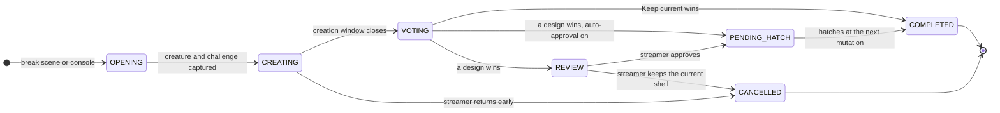

1. A break opens the studio, from a configured OBS scene through the OBS bridge or with one click in the console. The game clock checkpoints, so the break costs the creature nothing.
2. Only currently legal shell trade-offs are offered, or a labelled appearance-only option when none is legal.
3. Viewers sculpt during the creation window (five minutes by default, configurable from 10 seconds to 30 minutes). Drafts stay local until the artist confirms one bounded, declarative blueprint.
4. When creation closes, a recorded seeded draw picks at most two finalists, and chat votes between them and **Keep current**.
5. The streamer approves the winner or keeps the current shell. With auto-approval turned on, the winner is approved automatically, which is safe because every template is already bounded. An approved design waits on the overlay as a visible cocoon and hatches at the next mutation slot. Repeated breaks never create extra mutation slots.
6. Raid descendants inherit the committed design. Their passports credit the studio, the creating channel and, only when they opt in, the artist.

Coming back before creation closes cancels the session. Returning during the vote either lets it finish or cancels it, as the broadcaster configured.

<table>
  <tr>
    <td width="50%">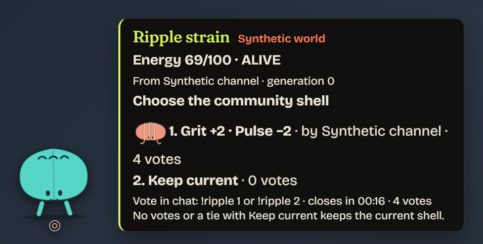</td>
    <td width="50%">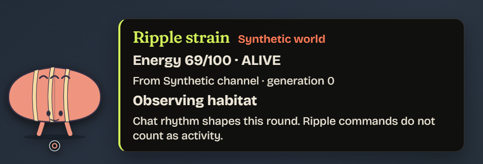</td>
  </tr>
  <tr>
    <td align="center"><sub>Chat picks between the finalists and <b>Keep current</b></sub></td>
    <td align="center"><sub>The winning shell hatches onto the creature</sub></td>
  </tr>
</table>

## How it plays

The central loop is **seed → choose → observe → adapt → raid → welcome → inherit → leave a trace**.

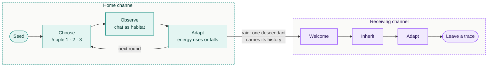

| Step                  | What happens                                                                                                                                                                                                                                                     |
| :-------------------- | :--------------------------------------------------------------------------------------------------------------------------------------------------------------------------------------------------------------------------------------------------------------- |
| **1 · Seed**          | A broadcaster names a founding strain. Its genome has four genes, **Pulse**, **Calm**, **Grit** and **Drift**, each from 0 to 15 and always summing to 24.                                                                                                       |
| **2 · Choose**        | Chat votes on three mutation cards drawn from a seeded shuffle of the legal moves. A mutation moves two points between two genes. Every account's first valid vote stands, ties fall to a seeded order, and no votes means Hold.                                 |
| **3 · Observe**       | For a fixed window, Ripple measures the channel's burst and steadiness (0 to 1000), one contribution per account per 10-second bucket. Confident observations need at least three distinct accounts; otherwise the round is labelled limited and health is held. |
| **4 · Adapt**         | An integer fitness contract scores the genome against the habitat, with Grit protection, capped shocks and clamps. Every signed contribution is explained, with its two leading causes. Energy at zero means extinction.                                         |
| **5 · Raid**          | When the streamer raids, one descendant branches into the destination channel with health derived from Drift. The parent always stays home. Destinations choose to ask, accept or reject, and can block sources or lineages.                                     |
| **6 · Welcome**       | The receiving community votes on a welcome choice, may grant finite shelter, and resolves contests against its incumbent under matched conditions. Losers become fossils that keep their final appearance. Overflow waits in a first-in, first-out harbor.       |
| **7 · Inherit**       | Children carry their genome, committed shell design, appearance mapping and origin marks, so every creature shows where its lineage has been.                                                                                                                    |
| **8 · Leave a trace** | A raid-origin survivor that thrives through two valid observations can earn a habitat trace. The host chooses Keep or Clear (Clear by default), and a kept trace changes the habitat for later residents and visitors until it expires.                          |

Viewer counts, bits and subscriptions never buy game power.

Every round is explained, not just scored. The channel view shows the creature's genes and energy, what actually changed and why, and how the founding genome would have fared under exactly the same conditions:

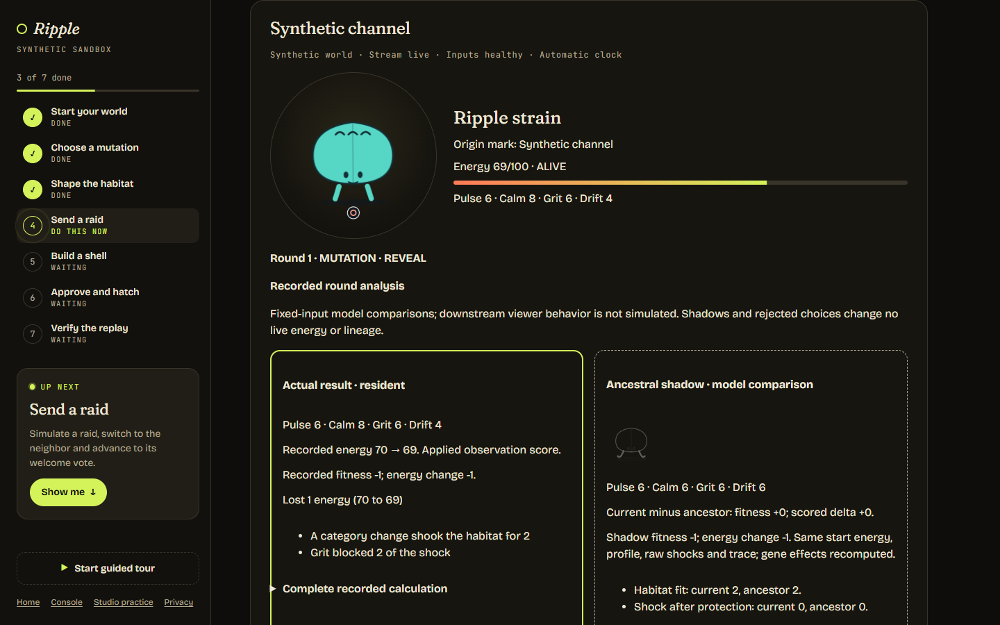

Raids grow a family tree. The lineage map follows every branch across channels, and each creature carries a passport of where it came from, the decisions that shaped it and the shell its community gave it:

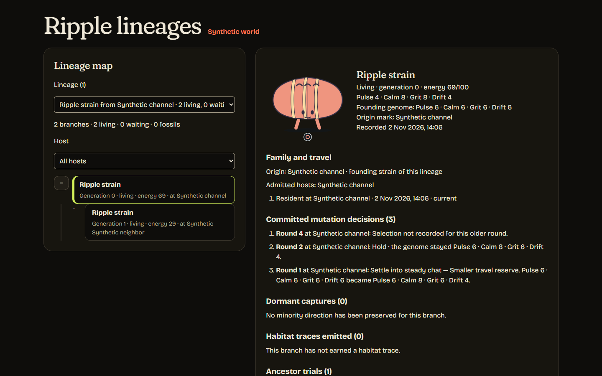

<details>
<summary><b>The deeper mechanics</b></summary>

| Mechanic          | What it does                                                                                                                                                                                                    |
| :---------------- | :-------------------------------------------------------------------------------------------------------------------------------------------------------------------------------------------------------------- |
| Dormant mutations | A losing direction backed by a qualified minority is captured. It can return once as a labelled, legally rebased card while its allowance lasts (three later valid observations), and raid children inherit it. |
| Ancestor trials   | Each resolved round also scores the lineage's founding genome against the same recorded inputs, so chat can see whether evolution actually helped.                                                              |
| Rejected choices  | The cards chat did not pick are evaluated against the same recorded start energy, habitat and shocks, and saved as clearly labelled comparisons.                                                                |
| Mutation previews | Estimates use only a recorded recent profile and are frozen when a ballot opens; with no valid history they say "Learning" instead of guessing.                                                                 |
| Resolution states | Applied, limited (an estimate with health held) or interrupted (nothing progresses, and it is never treated as a quiet round).                                                                                  |
| Family updates    | Births, admissions, fossils and earned traces are appended to a per-lineage log. When a channel comes back online it sees up to three updates from relatives elsewhere.                                         |
| Celebrations      | Optional cheers, subscriptions and hype trains show an eight-second thank-you labelled "Celebration only · no game advantage". The payer and the amount are never read or stored.                               |

Every mechanic is versioned. A world pins its mechanics policy, and existing channels keep their behavior until the owner explicitly enables a newer version at a safe round boundary.

</details>

## A stream, end to end

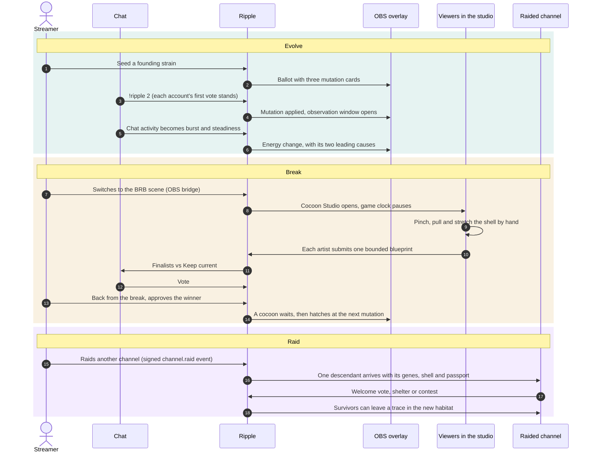

## Live demo

### **[ripple-oze8.onrender.com](https://ripple-oze8.onrender.com/)**

Open it in a desktop browser such as Chrome or Edge. There is nothing to install and no account to create. Everything you do happens in a private world made just for you, so you can try every control without affecting anyone else.

> [!TIP]
> The demo server is kept awake from 8 am to 8 pm US Pacific (15:00 to 03:00 UTC). Outside those hours it sleeps when nobody is using it, so if the first page is slow to appear, give it up to a minute to wake up; after that it responds normally.

### Try it in three minutes

1. Open the demo and choose **Try a three-minute expedition**, then **Start my sandbox**. You get a home channel and a neighbor channel that share a clock you advance yourself.
2. **Vote.** Choose **Synthetic vote 1**, then **Next scheduled step** to close the ballot and watch the creature's genes change.
3. **Survive.** Choose **Add local chat**, optionally **Change habitat**, and advance again. The channel card explains how its energy changed and why.
4. **Raid.** Choose **Simulate raid to other channel**, switch to **Neighbor channel** and follow the visitor through its welcome vote and its contest with the resident.
5. **Sculpt.** Back home, choose **Start break studio**. Shape the shell with your mouse, keyboard, touch or **Enable hand controls** for your webcam, then **Review and submit** and **Submit proposal**.
6. **Pick and hatch.** Advance to close creation, vote for your design, choose **Approve design**, and keep advancing until the new shell hatches onto the creature.
7. **Verify.** Open **Inspect round details** or **Lineage and passports**, then choose **Replay and verify** to rebuild both channels from their records and confirm they match. **Reset sandbox** starts a fresh world.

The [judge guide](docs/judge-guide.md) explains each step in more detail.

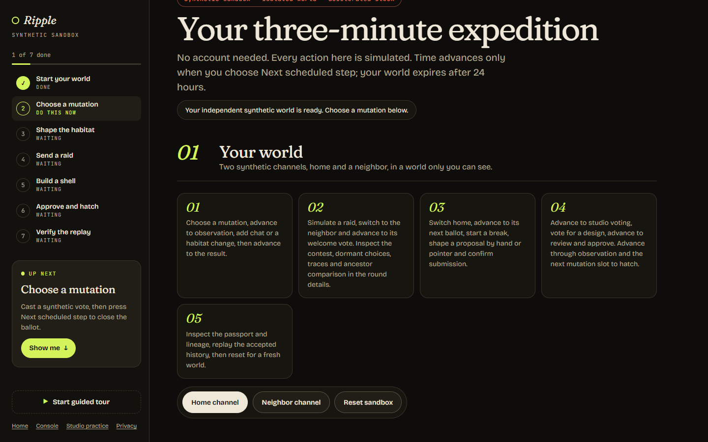

### What the demo includes

| Page                                                              | What you can do there                                                                                                                                                |
| :---------------------------------------------------------------- | :------------------------------------------------------------------------------------------------------------------------------------------------------------------- |
| [Landing page](https://ripple-oze8.onrender.com/)                 | Meet the game: how chat, the habitat, the break studio and raids fit together.                                                                                       |
| [Sandbox](https://ripple-oze8.onrender.com/sandbox)               | Play the whole loop as both the streamer and the chat: votes, chat activity, habitats, raids, a break studio, finalist voting, approval, hatching, replay and reset. |
| [Cocoon Studio practice](https://ripple-oze8.onrender.com/studio) | Sculpt a shell freely with your hands through a webcam, or with a mouse, touch or keyboard. Drafts stay on your device and are never submitted from this page.       |
| Round details, lineage and passports                              | Opened from inside your sandbox: a read-only live view of each channel, the family tree of every creature and the passport each descendant carries.                  |
| [Privacy](https://ripple-oze8.onrender.com/privacy)               | What Ripple stores, what it never collects and how deletion works.                                                                                                   |

Every sandbox action is clearly labelled synthetic, and each sandbox world expires after a day. The camera is optional: if you enable hand controls, video and hand landmarks stay in your browser and are never uploaded.

### What the demo does not include

The demo is not connected to Twitch. The sandbox drives the same game rules with synthetic chat, votes and raids, so you can see everything a channel would, but these parts need a real Twitch channel:

| Not in the demo                                                                         | How to see it                                                                                                                                                                                           |
| :-------------------------------------------------------------------------------------- | :------------------------------------------------------------------------------------------------------------------------------------------------------------------------------------------------------ |
| Real chat voting with `!ripple`, the chat bot, real raids and stream online and offline | Run your own copy with the [Twitch setup guide](docs/twitch-setup.md). In the demo, the sandbox's synthetic controls stand in for chat and raids.                                                       |
| Signing in to the broadcaster console with Twitch                                       | The [console](https://ripple-oze8.onrender.com/controller) opens, but connecting a channel needs Twitch. The sandbox gives you the same streamer controls on a synthetic channel.                       |
| The OBS overlay and scene bridge on a live stream                                       | The sandbox shows the same live channel state the overlay displays, and a manual **Start break studio** stands in for the scene bridge. OBS setup is in the [Twitch setup guide](docs/twitch-setup.md). |
| Twitch sign-in for studio artists and paid-event celebrations                           | Both need a live channel. Sandbox artists are synthetic, and celebrations never affect the game.                                                                                                        |

## Product surfaces

| Route         | Audience                | What it is                                                                                                                                   |
| :------------ | :---------------------- | :------------------------------------------------------------------------------------------------------------------------------------------- |
| `/`           | Everyone                | Scroll-told introduction to the loop, with live service status                                                                               |
| `/studio`     | Viewers and artists     | Cocoon Studio: hand, pointer, touch and keyboard editing; local practice with draft recovery and JSON download, or a live studio from a link |
| `/sandbox`    | Judges and visitors     | Keyless synthetic expedition: home and neighbor channels, accelerated clock, studio, replay and reset                                        |
| `/controller` | Broadcasters            | The console: Twitch connection, seeding, pause and recovery, visitor policy and blocks, mechanics, studio settings, display options, metrics |
| `/overlay`    | OBS browser source      | Transparent 1920×1080 creature and decision panel with server-aligned countdowns and explicit paused, offline and interrupted states         |
| `/bridge`     | OBS browser source      | Reports scene changes and heartbeats so a break scene can open the studio automatically                                                      |
| `/preview`    | Moderators and partners | Read-only detailed view of the channel's game, from a revocable link                                                                         |
| `/lineage`    | Communities             | Lineage map with collapsible family trees, fossils and traces, plus each branch's passport                                                   |
| `/privacy`    | Everyone                | Camera locality, retention, deletion and the effect of erasure on accepted designs                                                           |

The overlay is built for broadcasts: transparent at 1920×1080, silent, readable on stream and respectful of reduced-motion settings. Every browser journey runs accessibility checks.

## Architecture

Ripple is one TypeScript application service plus PostgreSQL, shipped as a single image. Browsers never talk to the database, and hand tracking runs in each viewer's browser, so no GPU or vision backend is needed.

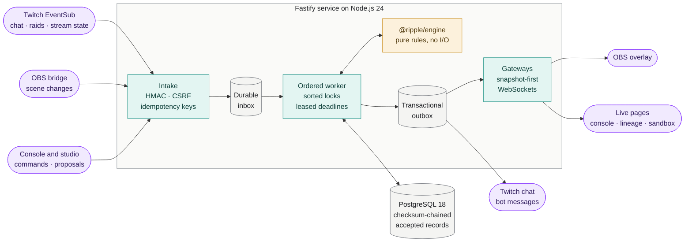

Every input is persisted before it is acknowledged, a per-channel worker applies it through the pure engine under sorted locks (up to 32 channels in parallel), and the resulting public updates and bot messages leave through a transactional outbox. PostgreSQL holds world-scoped state, checksum-chained accepted records, immutable ancestry and the per-lineage family log.

| Design rule                        | What it means in practice                                                                                                                                                                      |
| :--------------------------------- | :--------------------------------------------------------------------------------------------------------------------------------------------------------------------------------------------- |
| **Persist before acknowledging**   | Every input is stored before Twitch or a browser gets a reply, so a crash never loses a vote, a raid or a proposal.                                                                            |
| **One ordered worker per channel** | Inputs apply in order under sorted transaction locks, so both sides of a raid stay consistent and recovery after a crash or process gap is clean.                                              |
| **A pure engine**                  | `@ripple/engine` uses safe-integer arithmetic, versioned rulesets identified by the SHA-256 of their canonical JSON (RFC 8785) and seeded xoshiro128\*\* randomness. Same inputs, same result. |
| **Publish with the change**        | Public updates and bot messages commit in the same transaction as the game change that caused them, then deliver.                                                                              |
| **Snapshot-first sockets**         | WebSockets open with a current snapshot, carry complete versioned projections, reject client writes and repair missed updates from PostgreSQL.                                                 |
| **World isolation**                | Every record belongs to one world. Sandbox, replay and live worlds never mix, and live worlds reject synthetic clocks and commands on the server.                                              |
| **Scoped access**                  | Read capabilities are hashed at rest, travel in URL fragments or `Authorization` headers, and exchange for single-use, 30-second WebSocket tickets.                                            |
| **Vision at the edge**             | Camera, gesture and clock code stay out of the engine. The server only ever sees a validated, declarative shell blueprint.                                                                     |

## Determinism and replay

Accepted records are the source of truth. Each channel's records form a checksum chain, and cross-channel dependencies such as raids record the destination positions they observed.

```sh
npm run replay -- export WORLD_ID bundle.json   # every channel's accepted records
npm run replay -- verify bundle.json            # checksums, rules and dependency bounds
npm run replay -- run bundle.json               # rebuild in a new, isolated replay world
```

`run` rebuilds the world in channel order, waits for raid dependencies, prints each channel's resident, committed design and studio outcomes, and compares the result with the source world channel by channel, exiting with code 2 on any difference. Replay uses accepted records only: no camera data, landmarks or provider calls, which is exactly why a hand-sculpted shell replays identically.

## Security and privacy

| Area                | How Ripple handles it                                                                                                                                                                                              |
| :------------------ | :----------------------------------------------------------------------------------------------------------------------------------------------------------------------------------------------------------------- |
| **Webhooks**        | Verified with HMAC over the raw request bytes, deduplicated by receipt and reconciled against Twitch's subscription state                                                                                          |
| **Owner controls**  | Twitch sign-in sessions with `__Host-` cookies, an exact `Origin` check, CSRF tokens, idempotency keys and channel version checks                                                                                  |
| **Grants and keys** | Encrypted at rest with independent keys. Changing `ACTOR_HASH_KEY` refuses startup rather than silently changing vote identity                                                                                     |
| **Hardening**       | Security headers with a strict Content Security Policy, rate limiting and bounded input everywhere                                                                                                                 |
| **Camera**          | Video and hand landmarks stay in the browser, the microphone is never requested, and camera tracks stop when the studio closes                                                                                     |
| **Analytics**       | Only allow-listed events with counts and kinds: no viewer identities, chat text, video or landmarks. Live and sandbox populations are kept separate                                                                |
| **Erasure**         | Accepted records hold opaque credit tokens, so replay survives erasure. Retention runs every 30 seconds, and a separate erasure ledger keeps restores honest. See [privacy operations](docs/privacy-operations.md) |

## Twitch integration

Live integration is off by default, so local evaluation needs no secrets. When enabled, Ripple supports broadcaster and operator-bot OAuth with encrypted grants and refresh leases, signed EventSub intake with subscription reconciliation, chat voting and activity with Shared Chat deduplication, stream online and offline recovery, and bounded bot output through a committed outbox. Raids arrive as signed `channel.raid` notifications.

Open `/controller` on your own HTTPS installation to connect a channel. The [Twitch setup guide](docs/twitch-setup.md) lists the exact redirect URLs, scopes, operator bot authorization and an end-to-end checklist. For a rehearsal on a local machine behind an HTTPS tunnel:

```sh
docker compose -f compose.yaml -f compose.live.yaml up --build -d
```

## Run it locally

**The fastest way in** needs only Docker with Compose v2:

```sh
git clone https://github.com/ishaans04/Ripple.git
cd Ripple
docker compose up --build
```

Open <http://localhost:3000> and choose **Try a three-minute expedition**. No Twitch account, credentials or camera are needed; enable hand controls in the studio if you want to try sculpting with a webcam. Compose starts PostgreSQL, waits for it to become healthy, applies migrations once in a dedicated step, then starts the app. Stop it with `Ctrl+C` or `docker compose down`, and add `--volumes` to delete the database. The [judge guide](docs/judge-guide.md) walks through the full expedition.

**For development**, use Node.js 24 LTS (see `.nvmrc`) and Docker for PostgreSQL:

```sh
npm ci
cp .env.example .env
npm run db:up                    # PostgreSQL 18 on localhost:55432
npm run db:migrate
npm run dev -w @ripple/server    # API on http://localhost:3000
npm run dev -w @ripple/web       # web app on http://localhost:5173, proxying the API
```

Workspace packages resolve to their TypeScript sources through the `ripple-source` export condition; `npm run build` emits JavaScript for production.

| Script                                    | Purpose                                                                   |
| :---------------------------------------- | :------------------------------------------------------------------------ |
| `npm run lint`                            | ESLint with strict, type-aware rules                                      |
| `npm run format` / `format:check`         | Format with Prettier, or check formatting                                 |
| `npm run typecheck`                       | TypeScript across the root, every workspace and the browser tests         |
| `npm test`                                | Unit and property tests                                                   |
| `npm run test:integration`                | Integration tests against real PostgreSQL (`TEST_DATABASE_URL`)           |
| `npm run test:e2e`                        | Build, then run the browser journeys in installed Windows Chrome and Edge |
| `npm run build`                           | Compile the packages and server, and bundle the web app                   |
| `npm run db:up` / `db:migrate`            | Start PostgreSQL, or apply migrations                                     |
| `npm run db:generate -w @ripple/database` | Generate a migration from schema changes                                  |

<details>
<summary><b>Configuration</b></summary>

The server validates its environment at startup and stops with a message naming each invalid variable, without echoing values. See [`.env.example`](.env.example).

| Variable               | Default            | Meaning                                                                      |
| :--------------------- | :----------------- | :--------------------------------------------------------------------------- |
| `DATABASE_URL`         | required           | PostgreSQL connection string                                                 |
| `DATABASE_POOL_MAX`    | `48`               | Shared connection budget for HTTP, workers and gateways (8–64)               |
| `HOST` / `PORT`        | `0.0.0.0` / `3000` | Listener address                                                             |
| `LOG_LEVEL`            | `info`             | `fatal`, `error`, `warn`, `info`, `debug`, `trace` or `silent`               |
| `SHUTDOWN_GRACE_MS`    | `15000`            | Time to drain requests before forcing exit (1,000–120,000)                   |
| `WEB_ROOT`             | unset              | Built web app to serve; the Docker image sets it                             |
| `TEST_DATABASE_URL`    | unset              | Connection used by integration tests to create and drop temporary databases  |
| `ENABLE_LIVE_TWITCH`   | `false`            | Turns on the live Twitch integration; requires the variables below           |
| `ENABLE_COCOON_STUDIO` | `true`             | Installation-wide studio switch; each channel still opts in from its console |
| `ENABLE_CELEBRATIONS`  | `false`            | Optional cheer, subscription and hype train celebrations (presentation only) |
| `RULESET_VERSION`      | `candidate-1`      | Versioned balance parameters                                                 |

With `ENABLE_LIVE_TWITCH=true`, the server also requires:

| Variable                 | Requirement                                                  |
| :----------------------- | :----------------------------------------------------------- |
| `PUBLIC_BASE_URL`        | The stable HTTPS origin of the deployment                    |
| `TWITCH_REDIRECT_URI`    | `PUBLIC_BASE_URL` + `/auth/twitch/callback`                  |
| `TWITCH_CLIENT_ID`       | Twitch application client ID                                 |
| `TWITCH_CLIENT_SECRET`   | Twitch application client secret                             |
| `TWITCH_EVENTSUB_SECRET` | 32–100 printable ASCII characters                            |
| `TOKEN_ENCRYPTION_KEY`   | Independently generated 32-byte base64 key for stored grants |
| `SESSION_SECRET`         | Independently generated 32-byte base64 key                   |
| `ACTOR_HASH_KEY`         | Independently generated 32-byte base64 key; keep it stable   |
| `OPERATOR_SECRET`        | Independently generated secret of at least 32 characters     |

Keep real values in your host's secret store, never in the repository or a Docker build argument. The [Twitch setup guide](docs/twitch-setup.md) covers each step.

</details>

<details>
<summary><b>Troubleshooting</b></summary>

- **Port 3000 or 55432 is already in use.** Stop the other process, or change the published port in `compose.yaml`.
- **The page says the service cannot reach its database.** Run `docker compose ps` and check that `db` is healthy and `migrate` exited with code 0. Use `docker compose logs migrate app` for details.
- **The image is stale after pulling new code.** Rerun with `--build`.
- **Hand tracking feels slow.** It runs on your CPU. Close other heavy tabs and apps, face your palm to the camera in good light, and keep one-hand mode on.

</details>

## Testing and quality

| Suite                                                                                         | Command                    | Tests in the latest green run |
| :-------------------------------------------------------------------------------------------- | :------------------------- | ----------------------------: |
| Unit and property tests: engine rules, contracts, gestures, editor state and services         | `npm test`                 |                           490 |
| Integration tests on real PostgreSQL: ordering, crash and retry, raid races, studio, replay   | `npm run test:integration` |                           225 |
| Browser journeys in installed Chrome and Edge, including the studio with real model inference | `npm run test:e2e`         |                            98 |
|                                                                                               | **Total**                  |                       **813** |

CI runs on every push to `main`, and it checks more than tests:

- **Static checks.** ESLint with type-aware rules, Prettier formatting, TypeScript across every workspace, and a dependency-notice check that fails on any unlisted third-party license.
- **Fast-check properties** over every legal genome: the gene budget is conserved, cosmetic designs never change fitness, no mutation slot is committed twice, and out-of-bounds or executable blueprint content is rejected.
- **Hand tracking in real browsers.** The studio journeys run the actual MediaPipe model in a worker under the app's security headers, show that hand and pointer input produce identical blueprints, and prove that tracking loss never submits and a denied camera still leaves a working editor.
- **Accessibility.** axe-core WCAG 2.1 A and AA checks on every browser journey.
- **A Compose smoke test** starts the stack exactly as an evaluator would.
- **Two independent release-load trials**: signed HTTP intake, 300 live sockets, simultaneous studios and a worker killed after commit, with strict latency and durability gates.

<details>
<summary><b>More verification tools</b></summary>

| Tool                    | What it covers                                                                    | Command                |
| :---------------------- | :-------------------------------------------------------------------------------- | :--------------------- |
| Installed smoke tools   | Inside the production image: a round, raids, mechanics, a studio break, judge API | `npm run smoke:*`      |
| Installed judge journey | A real browser drives the installed app end to end with no intercepted requests   | `npm run test:judge`   |
| Policy simulator        | Six policies across six habitats on a held-out split, with reproducible results   | `npm run simulate`     |
| Restore rehearsal       | Real dump, separate-database restore, reapplied erasures and deterministic replay | `npm run test:restore` |
| Release load            | The load gates described above                                                    | `npm run test:load`    |

Measured results and their limits are recorded in the [replay and judge evidence](docs/evidence/phase9.md) and the [load and hardening evidence](docs/evidence/phase10.md).

</details>

## Tech stack

| Layer           | Built with                                                                                                          |
| :-------------- | :------------------------------------------------------------------------------------------------------------------ |
| **Language**    | TypeScript 6 in strict mode; sources run directly on Node.js 24 type stripping during development                   |
| **Server**      | Fastify 5 with `@fastify/websocket`, `@fastify/helmet`, `@fastify/rate-limit` and `@fastify/static`; `pg`; `ws`     |
| **Data**        | PostgreSQL 18; Drizzle ORM schema with versioned SQL migrations applied under an advisory lock                      |
| **Contracts**   | Zod 4 schemas shared by the server and the browser                                                                  |
| **Game engine** | Pure TypeScript with `@noble/hashes`, canonical JSON and seeded xoshiro128\*\*                                      |
| **Web**         | React 19, Vite 8 and CSS Modules; self-hosted Fraunces, Bricolage Grotesque and JetBrains Mono                      |
| **Vision**      | MediaPipe Tasks Vision 1.1.1 in a module worker, with a pinned, SHA-256-verified hand landmarker model              |
| **Testing**     | Vitest 5 with fast-check property tests, real-PostgreSQL integration tests, Playwright in Chrome and Edge, axe-core |
| **Quality**     | ESLint 10 with type-aware rules, Prettier 3, dependency-notice checks                                               |
| **Delivery**    | Multi-stage Docker image pinned by digest, Docker Compose, GitHub Actions and a Railway configuration               |

## Deployment and operations

Ripple runs anywhere that can run its Docker image next to a PostgreSQL database in the same region. Apply migrations before each start with `node packages/database/dist/cli/migrate.js`, then run `node apps/server/dist/main.js`. The included [`railway.json`](railway.json) does this as a pre-deploy step, gates rollout on `/health/ready` and drains connections for 20 seconds. A host that sleeps when idle is fine for the keyless sandbox, but a Twitch-connected installation must stay awake: webhooks, sockets and round deadlines need a running process.

| Endpoint        | Purpose                                                 |
| :-------------- | :------------------------------------------------------ |
| `/health/live`  | Liveness: the process is serving                        |
| `/health/ready` | Readiness: the database is reachable and migrations ran |

- [Deployment guide](docs/deployment.md): topology, sizing, backups and point-in-time recovery, cost.
- [Operations runbook](docs/operations.md): alerts, incident recovery, backup and restore, deploy and rollback.
- `npm run status` prints private backlog, deadline, delivery and database diagnostics.

<details>
<summary><b>Command-line tools</b></summary>

All tools run from source with `npm run <script>`, and the production image ships them under `apps/server/dist/cli/`.

| Script                               | Purpose                                                                                              |
| :----------------------------------- | :--------------------------------------------------------------------------------------------------- |
| `sandbox`                            | Create and drive isolated synthetic worlds: votes, activity, raids, studio breaks, pauses and claims |
| `smoke:game` / `raids` / `mechanics` | Verify a synthetic round, a two-channel raid, or earned mechanics against a running app              |
| `smoke:studio` / `smoke:judge`       | Verify a studio break through hatch and raid, or the keyless judge API journey                       |
| `test:judge`                         | Drive the installed app in a real browser with no intercepted requests                               |
| `simulate`                           | Run the deterministic policy and studio simulator                                                    |
| `replay`                             | Export, verify and rebuild a world from accepted records                                             |
| `metrics`                            | Print product and studio metrics with numerators, denominators and limits                            |
| `privacy`                            | Targeted erasure, expired-world purge and the erasure ledger                                         |
| `status`                             | Private operational diagnostics                                                                      |
| `test:load` / `test:restore`         | Release load test, and the dump and restore rehearsal                                                |
| `release:package`                    | Package the exact validated source with a SHA-256 manifest                                           |

`npm run sandbox -- create` creates and seeds a labelled synthetic world that expires after 24 hours, and returns its IDs, a private owner capability, a read capability and a snapshot. Set `RIPPLE_SANDBOX_CAPABILITY` to the owner capability, then use the returned IDs:

```sh
npm run sandbox -- vote WORLD_ID CHANNEL_ID alice 2
npm run sandbox -- advance WORLD_ID CHANNEL_ID 3200
npm run sandbox -- activity WORLD_ID CHANNEL_ID alice
npm run sandbox -- advance WORLD_ID CHANNEL_ID 12000
npm run sandbox -- status WORLD_ID CHANNEL_ID
```

| Commands                                                                         | Purpose                                                              |
| :------------------------------------------------------------------------------- | :------------------------------------------------------------------- |
| `vote`, `activity`, `advance`, `status`                                          | Drive ballots and observations on the shared synthetic clock         |
| `pause`, `resume`, `offline`, `online`, `input-outage`, `recover`                | Exercise pauses, stream outages and interrupted-observation recovery |
| `peer`, `seed`, `policy`, `prepare`, `raid`, `admit`, `decline`                  | Add up to eight channels, raid between them and manage admission     |
| `block-source`, `block-lineage`, `raid-unknown`, `claim`                         | Blocks, raids to unenrolled channels and historical adoption         |
| `enable-mechanics`, `traces`, `clear-traces`                                     | Mechanics upgrades and trace controls                                |
| `studio-settings`, `studio-start`, `studio-stop`, `bridge-scene`, `bridge-stale` | Studio configuration, manual breaks and simulated OBS bridge reports |
| `studio-propose`, `studio-withdraw`, `studio-review`, `studio-release`           | Synthetic artists, review and release                                |

Each `advance` accepts 1–300,000 milliseconds and returns an operation UUID; passing it again retries the same step without advancing twice. Live worlds reject synthetic clocks and commands.

</details>

<details>
<summary><b>HTTP and real-time API</b></summary>

| Area              | Endpoints                                                                                                                                                           |
| :---------------- | :------------------------------------------------------------------------------------------------------------------------------------------------------------------ |
| Health            | `GET /health/live`, `GET /health/ready`                                                                                                                             |
| Scoped reads      | `GET /api/worlds/:id/snapshot`, `GET /api/lineages`, `GET /api/lineages/:id`, `GET /api/organisms/:id/passport`, `GET /api/rounds/:id/explanation`                  |
| Real time         | `POST /api/overlay/exchange` for a single-use 30-second ticket, then the `/api/live` WebSocket                                                                      |
| Broadcaster       | `/api/controller/*` (status, commands, blocks, metrics, read capability, studio) and `/api/channels/:id/*` (seed, control, studio settings, start and stop, bridge) |
| Studio and artist | `/api/studios/:id`, proposals, review and release; `/api/blueprints/:hash`; `/api/artist/status`; `POST /api/artist/forget`                                         |
| Sandbox           | `POST /api/sandbox`, then `/api/sandbox/:worldId/actions`, `/replay` and `/reset`                                                                                   |
| Twitch            | `/auth/twitch/start`, `/auth/twitch/bot/start`, `/auth/twitch/artist/start`, `/auth/twitch/callback`, `POST /webhooks/twitch`                                       |
| Analytics         | `POST /api/analytics` for allow-listed anonymous events                                                                                                             |

Scoped reads take `worldId` and `channelId` query parameters and `Authorization: Bearer <read capability>`. Owner writes require a signed-in session, a CSRF token, an idempotency key and the current channel version. WebSocket vote aggregates are limited to twice per second.

</details>

## Repository layout

Ripple is an npm workspaces monorepo. The **server** (`apps/server`) owns every write: it takes in Twitch events and browser commands, orders them per channel and asks the **engine** (`packages/engine`) what happens next. The **web app** (`apps/web`) renders every screen, including the studio, where hand tracking runs locally. Both sides share the **contracts** (`packages/contracts`), and the **database** package (`packages/database`) owns the schema and migrations.

```text
Ripple/
├── apps/
│   ├── server/src/
│   │   ├── game/           ordered worker, rounds, raids, studio, gateways, replay, metrics
│   │   ├── twitch/         OAuth grants, EventSub intake, chat, bot output, celebrations
│   │   ├── routes/         health, scoped reads, sandbox, public studio and analytics
│   │   ├── privacy/        artist credits, erasure ledger, retention maintenance
│   │   ├── simulator/      policy, habitat, adversarial and studio scenarios
│   │   ├── release/        load-test server, crash worker and studio fixture
│   │   └── cli/            sandbox, smoke, replay, simulate, metrics, privacy, status, load
│   └── web/src/
│       ├── studio/         Cocoon Studio: hand worker, camera, gestures, editor, shell renderer
│       ├── landing/        the scroll-told landing page
│       ├── controller/     the broadcaster console
│       ├── overlay/        the transparent OBS overlay
│       ├── bridge/         the OBS scene bridge
│       ├── sandbox/        the keyless judge expedition
│       ├── lineage/        lineage map and passports
│       ├── creature/       creature rendering shared by every screen
│       └── realtime/       snapshot-first WebSocket client
├── packages/
│   ├── engine/             pure, deterministic rules: genome, ballots, habitat, raids, studio
│   ├── contracts/          Zod schemas shared by the server and the browser
│   └── database/           Drizzle schema, SQL migrations and the migration runner
├── tests/                  browser journeys, installed-judge check, restore rehearsal, packager
├── docs/                   specification, guides, runbooks, measured evidence and demo
├── .github/workflows/      the CI pipeline
├── Dockerfile              multi-stage production image
├── compose.yaml            PostgreSQL, migrations and the app for local evaluation
├── compose.live.yaml       overrides for a live Twitch rehearsal behind HTTPS
└── railway.json            Railway deploy, pre-deploy migrations and health gate
```

## Limits, stated up front

| Limit                                             | Why it is there                                                                                                                                 |
| :------------------------------------------------ | :---------------------------------------------------------------------------------------------------------------------------------------------- |
| Hand tracking runs on the **viewer's CPU**.       | Keeping inference in the browser keeps video private and needs no server GPU, so responsiveness depends on the device. Other inputs are equal.  |
| A design is **one shell with one marking layer**. | A bounded, declarative blueprint keeps every creature readable on stream and safe to render. There are no free-form meshes or uploaded images.  |
| Shape is **expression, not power**.               | The gene trade-off is fixed by the session's legal template, so a bigger or better-drawn shell never wins fitness.                              |
| Coming back early **cancels an open studio**.     | Creation belongs to the break. Set the creation window to match a typical break; returning during the vote can finish or cancel, as configured. |
| Payments and viewer counts **buy nothing**.       | Cheers, subscriptions and hype trains only show a thank-you. The payer and the amount are never read or stored.                                 |
| Sandbox worlds are **synthetic and short-lived**. | They run on an accelerated clock you control, label every synthetic action, expire after a day and never mix with Twitch-connected worlds.      |

## Documentation

| Document                                                | Contents                                                             |
| :------------------------------------------------------ | :------------------------------------------------------------------- |
| [Product specification](docs/prd.md)                    | Game model, rules, architecture, data model and API                  |
| [Cocoon Studio specification](docs/cocoon-studio.md)    | The studio addendum: flows, gestures, rules, privacy and tests       |
| [Judge guide](docs/judge-guide.md)                      | The three-minute sandbox expedition and replay tools                 |
| [Twitch setup](docs/twitch-setup.md)                    | Accounts, redirect URLs, secrets and end-to-end checklists           |
| [Deployment](docs/deployment.md)                        | Hosting topology, sizing, backups and cost                           |
| [Operations](docs/operations.md)                        | Monitoring, incidents, restore, deploy and rollback                  |
| [Privacy operations](docs/privacy-operations.md)        | Retention and deletion procedures                                    |
| [Replay and judge evidence](docs/evidence/phase9.md)    | Balance, simulator, replay and judge measurements                    |
| [Load and hardening evidence](docs/evidence/phase10.md) | Load, restore, client performance and hardening results              |
| [Recorded walkthrough](docs/demo/README.md)             | What the recorded sandbox walkthrough shows, and how to reproduce it |

## Built for the Codex × TwitchCon Hackathon

> **Codex × TwitchCon Hackathon** · OpenAI × Twitch · 23 October to 2 November 2026<br>
> [Hackathon page](https://twitchcon-codex.devpost.com/) · [Official rules](https://twitchcon-codex.devpost.com/rules)

The hackathon asks developers to build, with OpenAI Codex, an interactive experience for streamers and their communities that connects to Twitch. Ripple's answer starts from the least interactive part of any stream, the break, and turns it into the moment the whole community creates something together.

| The hackathon asks for                                | How Ripple answers                                                                                                                                                            |
| :---------------------------------------------------- | :---------------------------------------------------------------------------------------------------------------------------------------------------------------------------- |
| **Built for streamers and their community on Twitch** | Chat evolves a shared creature, the community sculpts its shell during breaks, and raids carry that creation into other channels with credit to where it came from.           |
| **An interactive experience that connects to Twitch** | Chat voting with `!ripple`, chat activity as the habitat, signed EventSub intake for raids and stream state, Twitch sign-in, bot messages and a transparent OBS overlay.      |
| **Built with OpenAI Codex**                           | Developed with Codex as the coding agent, with a recorded principal session and measured before-and-after evidence. See [How Codex was used](#how-codex-was-used).            |
| **Source, assets and instructions to run it**         | Try the [live demo](#live-demo) in a browser, or start everything locally with `docker compose up --build`. The keyless sandbox covers the whole loop in about three minutes. |

| Judging criterion                                                                      | Where Ripple stands                                                                                                                                                                                         |
| :------------------------------------------------------------------------------------- | :---------------------------------------------------------------------------------------------------------------------------------------------------------------------------------------------------------- |
| **Potential impact**: how useful or entertaining is it for streamers and communities   | Breaks stop being dead air. Every viewer gets a voice, a vote and a way to create, raids gain a story, and no payment or viewer count ever buys game power.                                                 |
| **Technological implementation**: how well is it built, and how well does it use Codex | A pure, deterministic engine with whole-world replay, durable ordered processing, in-browser hand tracking with no video upload, and 813 tests across unit, real-PostgreSQL integration and browser suites. |
| **Design**: is it easy to use and fun to watch                                         | Three cards and one chat command to vote, a creature that visibly changes, a 1920×1080 overlay readable on stream, sculpting with your bare hands, and accessibility checks on every browser journey.       |

### How Codex was used

Ripple was built with OpenAI Codex as the coding agent: implementing features, investigating failures, and reproducing and fixing defects against real PostgreSQL with measured before-and-after results. The principal Codex session is `01a18d83-decb-7e01-8cbe-e6c69963d4ab`.

One recorded iteration from the [project evidence](docs/evidence/phase9.md): the judge sandbox returned HTTP 500 on its next step because PostgreSQL rejected an aggregate over the world clock. After that fix, two further defects were reproduced against the earlier source revision and fixed with stable synthetic account keys and an advisory transaction lock:

| Observation                                                    | Before          | After                           |
| :------------------------------------------------------------- | :-------------- | :------------------------------ |
| The same four synthetic accounts click different choices twice | 8 votes counted | 4; each first valid vote stands |
| Two concurrent creations compete for one remaining slot        | Both enter      | One enters; one is rejected     |
| Regression checks                                              | 0 pass, 2 fail  | 2 pass, 0 fail                  |

The [machine-readable evidence](docs/evidence/phase9-repair.json) keeps the commands, environment, source revisions, assertions and failures. Ripple itself needs neither Codex nor an OpenAI API key to run.

## Author

**Ishaan Sharma** · [github.com/ishaans04](https://github.com/ishaans04) · [sharmaishaaan04@gmail.com](mailto:sharmaishaaan04@gmail.com)

## Acknowledgements and license

Hand tracking uses Google's [MediaPipe](https://ai.google.dev/edge/mediapipe) Tasks Vision runtime and hand landmarker model under the Apache-2.0 license, served locally from pinned, checksum-verified files. Typefaces are self-hosted from Fontsource. Full attributions and license texts are in [THIRD_PARTY_NOTICES.md](THIRD_PARTY_NOTICES.md).

This repository does not yet include a license file. Third-party components keep their own licenses.

<div align="center">
<br>
<sub><b>Ripple</b> · Turn the BRB screen into the best part of the stream. · <a href="#-ripple">Back to top ↑</a></sub>
</div>
