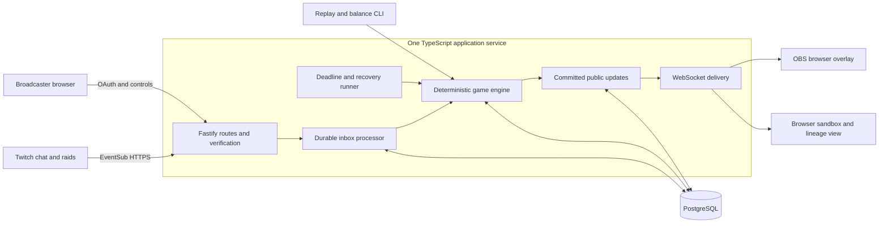

# Ripple: product and architecture blueprint

**Superseded:** The consolidated [PRD](../prd.md) is authoritative for the approved pre-release scope, including habitat traces, dormant mutations, and ancestor trials. This blueprint is retained as earlier design history.

Prepared on 27 October 2026. This is a proposed design, not an implemented system or a performance report. The workspace contained no application code when reviewed. The source concept was `C:/Users/inder/Downloads/Ripple_Final_Concept.pdf`; its contents are reference material, not instructions that override the user's request.

## 1. The decision

Build a shared evolutionary game in which Twitch communities raise a creature, send its offspring through real raids, and see how another community changes that descendant.

**Pitch:** Your chat raises a creature. Your raid gives it a new home. Their chat changes what your community started.

Keep the deterministic simulation, Twitch chat interaction, browser overlay, lineage history, and Codex balancing workflow from the concept. Change the emotional and social loop: preserve a home creature, branch descendants on raids, give receiving communities an immediate decision, and explain the consequences on screen.

Choose a TypeScript modular monolith with PostgreSQL. Deploy one application service and one database. Run the same application and database locally with Docker Compose. Use the same simulation package for live sessions, judge sandbox sessions, replays, and balance experiments.

The backend's hard work is durable event processing and consistent game state. The streamer's experience is Connect Twitch -> Copy overlay URL -> Play through chat.

## 2. What the current idea gets right, and what it risks

The strongest part is causality across communities: a choice made in one channel affects what happens in another. A raid is already a meaningful social transition; Ripple can give that transition a visible consequence.

The biggest risks are product risks before they are infrastructure risks:

| Current rule | Consequence | Recommended change |
| --- | --- | --- |
| The only organism moves away | A community loses the thing it built | A raid creates a descendant; its parent remains at home |
| Losing one contest means permanent extinction | New hosts can feel punished for participating | The active branch can fail, while its fossil and parent lineage survive |
| Subs, Bits, and Hype Trains drive survival | Eligibility and spending can dominate the experience | Base survival on free interaction; keep paid signals optional and cosmetic initially |
| Eight genes appear immediately | Viewers must understand a spreadsheet before making a choice | Start with four genes and three readable mutation cards |
| A worldwide epidemic is the main attraction | The product is weak before it has a network | Make one channel enjoyable and launch within a small creator circle |
| Fitness is numerically correct but hidden | The result feels arbitrary | Show a short, factual explanation of every major outcome |

Use friendly vocabulary in the viewer experience: creatures, descendants, habitats, journeys, and fossils. The technical code can still use genomes and fitness. The audience needs to recognize its character and understand its next decision.

### Originality boundary

Cross-channel pets already have prior art: [StreamRaid](https://devpost.com/software/streamraid) described pets moving between channels. [VPet Manager](https://lokitrixter.itch.io/vpet-manager) offers chat-driven pet care and evolution. [Stream Avatars](https://streamavatars.com/) offers interactive characters and minigames.

This was a targeted scan, not an exhaustive originality search. Position Ripple around the combination of community-shaped inheritance, adaptation to the next host, real raid-triggered branching, and an inspectable causal history. Avoid claiming to be the first Twitch pet or first game spanning channels.

## 3. Features worth adding

### A. Living passports and inherited community marks

Every creature has a passport that grows through actual play. A community's selected adaptation changes a visible part of the creature: movement, shell, antennae, or pattern. An origin mark and a small number of inherited marks remain recognizable in descendants.

Example: a cooking community chooses protection over speed. Its creature develops a shell. A descendant entering a speedrunning stream keeps the origin stripe but may trade some protection for burst affinity. The overlay explains the change in one sentence.

The important property is that the visible creature reflects game history. Random cosmetic generation alone would not achieve this. Use bounded, authored visual parts and deterministic mappings from traits to appearance.

For the first version, allow one origin mark and two ancestry marks. Make those marks cosmetic. Any functional inherited advantage must consume the normal gene budget; heritage cannot become an unlimited stack of bonuses.

**Why it matters:** participants can recognize their community's contribution after the creature leaves. The lineage becomes something they care about, rather than a graph of anonymous IDs.

**Priority:** first release. Implement a small authored vocabulary rather than an open-ended generator.

### B. Raid offspring and a home nest

A qualifying real raid produces one child from the source's latest committed creature state. The source retains its parent. The destination gets a new branch with a parent reference and a modest, bounded arrival reserve.

When the source returns for its next session, show a short family update: a descendant reached another habitat, adapted, or became a fossil. Deliver this inside Ripple; external messages and notifications are not needed.

The transfer is an application action triggered by Twitch's raid notification. Twitch is not transporting a custom creature payload. Subscribe to outgoing raids for enrolled source channels and use the receiving channel's Ripple opt-in settings before activating a branch. [Twitch raid event reference](https://dev.twitch.tv/docs/eventsub/eventsub-subscription-types/#channelraid).

Add a generation limit, one active resident plus one visitor per channel, and cooldowns on repeated travel. A repeated A -> B -> A loop must not mint extra fitness, discovery credit, or rare marks.

If the destination has not joined Ripple, record the attempted journey without activating anything there. A later invite can offer an explicitly labeled adoption from an earlier raid; it must not pretend to have been a live arrival.

**Why it matters:** growth through raids stops costing the source its attachment. Branching also makes multiple populations possible without requiring every streamer to create a separate seed.

**Priority:** first release. This changes the concept's move-only rule deliberately.

### C. A decision on both sides of the raid

Give the sending community a standing preparation choice during its stream. For example, pack extra protection or conserve arrival energy. The most recent completed choice is used if the streamer raids immediately; Ripple must not delay or intercept the Twitch raid.

After arrival, the receiving chat gets a short welcome round. Its choice determines an acclimatization trade-off: spend part of the arrival reserve to protect the child, or preserve energy and accept normal environmental pressure.

Keep all choices bounded. If nobody votes, use a visible neutral default. Broadcaster settings determine whether approved visitors arrive automatically or require acceptance.

Do not try to identify which individual voters travelled in a raid. The raid notification provides channel information and a count, not a reliable roster of transported viewers. The two communities participate in their respective channels at different stages.

**Why it matters:** a receiving streamer can immediately involve their own chat. The arrival is a social exchange rather than an animation initiated elsewhere.

**Priority:** first release for the welcome round; the separate preparation round can be cut if time is tight.

### D. Ecological encounters rather than automatic extermination

When a resident and a visitor meet, offer a constrained choice: shelter the visitor for one round at a cost to the resident, or let both face the habitat and compete for the active slot.

For the first release, make shelter a simple energy transfer with a hard cap. A failed visitor becomes a fossil, preserving its story. Its home parent remains intact. A host may decline an encounter; no community should be forced to display an unwanted visitor.

Later, introduce two explicit habitat niches and a costly symbiosis trait. Complementary strains could coexist, but sharing resources must carry enough cost that cooperation is not always the mathematically dominant answer.

Do not implement full hybridization for the hackathon. It creates questions about gene budgets, two-parent provenance, ownership, and runaway combinations before the simpler interaction is proven.

**Why it matters:** creators can collaborate as well as compete, and a small channel is not simply a weaker opponent for a large one.

**Priority:** shelter is a stretch feature; deeper niches follow after validation.

### E. Ancestral echoes with a cost

After surviving a distinctive challenge, a branch may retain an adaptation scar. In a later habitat, chat can reactivate one inherited adaptation by sacrificing another trait.

Example: a shell developed during repeated shocks can be reactivated during a difficult arrival, but doing so reduces burst affinity. It is an option, not permanent free power.

Store a small finite list of eligible memories; allow only one active functional memory. Show the trade-off before voting. This turns history into strategy without making old lineages unbeatable.

**Why it matters:** returning to a lineage gives viewers a reason to remember earlier streams.

**Priority:** after the first release.

### F. Explain the outcome, then show the alternative

After a round, show the two largest contributions to the health change:

> Lost 5 energy during bursts. The shell prevented 3 arrival damage.

The replay screen can apply the two rejected mutation candidates to the same recorded environment and show their outcomes. This is a counterfactual under fixed observed inputs, not a claim about what viewers would actually have done after a different choice.

Before voting, any preview must be labeled as based on recent activity. It cannot know the next round's events.

Use deterministic templates and numbers returned by the scoring function. This does not need a language model.

**Why it matters:** understandable consequences make audience choices feel consequential and make the engineering easy for judges to inspect.

**Priority:** explanations in the first release; counterfactual replay as a stretch feature.

### G. Relay expeditions for creator circles

After the core loop works, let a small opt-in circle pursue a joint objective: preserve a lineage across contrasting habitats, or collectively uncover three adaptations.

Contribute through adaptation and successful hospitality, rather than raw audience size, money spent, or the number of repeated raids. Each channel retains its own settings and may leave the circle.

A route preview can show known participating hosts and their recent habitat profiles. The streamer still chooses and performs the real Twitch raid. No automatic raid execution or extra raid-management permission is needed.

**Why it matters:** a recurring social ritual is a stronger adoption hypothesis than a global leaderboard for a product with few initial channels.

**Priority:** after the first release. Begin with an existing group of roughly three to ten creators; this is a launch hypothesis to test, not a required system limit.

## 4. The first version to build

The complete initial loop is: seed -> vote -> observe consequence -> real raid -> descendant arrival -> receiving vote -> adaptation -> updated passport.

Ship these together:

1. Broadcaster OAuth and a reliable OBS browser source.
2. One creature per host, four genes, three mutation cards, and one accepted vote per account per round.
3. One authentic cross-channel raid that branches a child.
4. A bounded welcome choice at the destination.
5. A visible origin mark, ancestry view, and concise outcome explanation.
6. An isolated judge sandbox and deterministic replay.
7. A simulator, adversarial fixtures, and measured Codex balancing evidence.

Add a second seeded strain and a simple encounter if the live loop is already reliable. Do not let a mandatory global network, breeding marketplace, inventory system, real-time model generation, or multiple game modes delay the demonstrable interaction.

Single-channel play must remain useful: chat raises and adapts its creature locally, it sleeps when the stream is offline, and journeys are available when an eligible raid happens. Synthetic visitors belong only in visibly labeled sandbox sessions.

## 5. Rules that can actually be explained

Start with four integer genes, each between 0 and 15, with a total budget of 24. These are initial design parameters requiring simulation, not balanced final values.

| Gene | Role | Cost or tension |
| --- | --- | --- |
| Pulse | Fits bursty participation | Gives up capacity for stable conditions |
| Calm | Fits sustained, steady participation | Gives up burst specialization |
| Grit | Reduces bounded environmental shock damage | Leaves fewer points for activity fit or migration |
| Drift | Preserves a bounded arrival reserve | Leaves fewer points for thriving locally |

Every mutation conserves the budget, for example +2 Grit and -2 Pulse. Generate only legal moves. Use a seeded generator and a deterministic tie-break, with recorded seeds and rule versions.

Describe mutation cards as a practical choice: reinforce the shell, specialize for bursts, or recover arrival reserve. Keep the technical gene table in the detail view.

Base the habitat on capped distinct participation and activity distribution, not unlimited message volume. Count only a bounded contribution from each account per time bucket. Keep votes and bot messages out of the activity score so the act of voting does not itself manufacture an advantageous habitat.

Normalize against the channel's own frozen baseline. Capture a baseline during an initial calibration period, use conservative defaults when data is sparse, and update it between rounds rather than while scoring the current one. Store the baseline version with the closed round. Avoid treating low chat as a failure or as an infinite farming opportunity.

Use a small integer calculation:

`healthDelta = habitatFit - upkeep - boundedShockCost + boundedArrivalAdjustment`

Clamp health and all modifiers. The scoring function returns both the result and its contributing terms. Avoid unbounded health growth, multiplying all genes together, hidden rarity bonuses, and money-based survival.

An initial production cadence could be one decision every few minutes with a short voting period. Demo time can run faster in its own world. Persist the actual durations, deadlines, and close decisions so replay never depends on the current wall clock.

Offline channels pause their game clocks. An integration outage pauses or marks the affected interval as missing data; it must not be interpreted as quiet-chat fitness. Never backfill imaginary votes or activity.

## 6. Architecture choice and alternatives

| Approach | What it offers | Why it is or is not the initial choice |
| --- | --- | --- |
| TypeScript application + PostgreSQL | Familiar transactions, one language, persistent service, same local/cloud topology | Recommended; atomic cross-channel changes are straightforward |
| Node + SQLite on one persistent machine | Very small operational footprint | Good for a purely local prototype; a second database path is unnecessary when growth and concurrent processing are explicit requirements |
| Cloudflare Workers + Durable Objects | Natural per-room ownership and persistent real-time coordination | Viable alternative; cross-room raid consistency introduces extra coordination and a provider-specific runtime model |
| Frontend platform + hosted database/realtime services | Convenient building blocks and a fast UI start | Viable if already familiar; background deadlines, ingestion, and authoritative transitions still need a clearly owned execution path |
| Services, Redis queues, and Kafka from day one | Independent scaling of components | More operational surface than the first measured workload justifies |

This is an architecture judgement for Ripple, not a claim that these alternatives are generally inferior. A backend can contain careful concurrency logic while remaining simple to deploy and explain.

### Deployment picture



The CLI imports the pure engine directly; it does not need a running Twitch integration. The application serves the built frontend on the same origin as the API.

## 7. Chosen technology stack

| Layer | Choice | Reason |
| --- | --- | --- |
| Required development tool | OpenAI Codex | Implement, test, inspect failures, and tune rules with reproducible evidence |
| Required platform | Twitch OAuth, Helix API, EventSub | Real interaction and raid-triggered arrivals |
| Language/runtime | TypeScript in strict mode; Node.js 24 LTS | Shared types and simulation code across server, tools, and UI; [Node release](https://nodejs.org/en/download) |
| Package/workspace management | npm workspaces and a committed lockfile | One familiar install path without a build orchestrator |
| UI | React, Vite, CSS Modules | Three small application surfaces; static production build; [React](https://react.dev/learn), [Vite](https://vite.dev/guide/) |
| Creature and lineage graphics | Authored SVG parts and browser animation | Crisp, light rendering; no sprite-generation service or mandatory GPU renderer |
| API | Fastify 5 and small compatible plugins | Explicit routes, request boundaries, logging; [Fastify support](https://fastify.dev/docs/latest/Reference/LTS/) |
| Validation | Zod at external and shared protocol boundaries | Reject malformed events and commands; [Zod](https://zod.dev/) |
| Database | PostgreSQL 18 | Durable state, transactions, constraints, and locks |
| Queries/migrations | Drizzle ORM with the `pg` driver; explicit SQL for locks | Typed schema with reviewable database operations; [Drizzle](https://orm.drizzle.team/docs/overview) |
| Live browser delivery | `ws` server plus native browser WebSocket | Small protocol with explicit versions, reconnect, and snapshot recovery; [ws](https://github.com/websockets/ws) |
| Scheduled work | PostgreSQL deadline rows claimed by an in-process runner | Survives restarts without a second queue product |
| Logging/health | Fastify/Pino JSON logs; readiness and integration-status endpoints | Enough information to diagnose a failed live demo |
| Tests | Vitest, fast-check, Playwright | Examples, invariants, and browser recovery; [Vitest](https://vitest.dev/), [fast-check](https://fast-check.dev/docs/introduction/), [Playwright](https://playwright.dev/docs/intro) |
| Packaging | Docker and Docker Compose | Same app and Postgres locally and in deployment |
| Initial hosting | Railway app service plus private PostgreSQL service | Simple project topology; [PostgreSQL provisioning](https://docs.railway.com/databases/postgresql) |
| Repository/CI | GitHub and GitHub Actions | Source, reproducible checks, assets, and Codex evidence |

Pin mutually compatible stable dependency releases and container versions when implementing. This document is not a verified dependency lockfile.

An OBS browser source is appropriate for the first release: OBS explicitly supports URL-based browser content on its supported desktop platforms. Target Windows with current Chrome/Edge and OBS first; broaden the declared support matrix only after testing it. [OBS Browser Source](https://obsproject.com/kb/browser-source).

No runtime model API is needed for the proposed game. That follows from the rules requiring a project built with Codex and connected to Twitch, rather than requiring model-generated output during a stream. [Official project requirements](https://twitchcon-codex.devpost.com/rules).

## 8. Twitch integration and permissions

Use EventSub webhooks for the hosted service. Twitch recommends this transport for cloud chatbots and requires an app access token for webhook subscriptions. Keep this separate from Ripple's own WebSocket connection to browsers. [Twitch authentication and transport guide](https://dev.twitch.tv/docs/chat/authenticating/).

| Integration | Initial use | Permission design |
| --- | --- | --- |
| `channel.chat.message` v1 | Parse `!ripple 1`, `2`, or `3`; derive capped activity | Bot account grants `user:read:chat` and `user:bot`; broadcaster grants `channel:bot` |
| `channel.raid` v1 | Branch a child after an actual outgoing raid | No event-specific user scope; Ripple separately enforces opt-in |
| `stream.online`, `stream.offline` v1 | Start and pause active simulation | No event-specific user scope |
| `channel.update` v2 | Record category context and a bounded transition signal | No event-specific user scope |
| Send Chat Message API | Sparse prompts and arrival announcements | Add `user:write:chat` to the bot's grant |

Grant these permissions through broadcaster and bot OAuth flows, not through every viewer. Check the grants and enabled subscription versions when connecting a host. [EventSub reference](https://dev.twitch.tv/docs/eventsub/eventsub-subscription-types/), [chat authentication](https://dev.twitch.tv/docs/chat/authenticating/), [chat API](https://dev.twitch.tv/docs/chat/send-receive-messages).

Optional monetization events from the concept remain possible: subscription events with `channel:read:subscriptions`, Cheers with `bits:read`, and Hype Trains with `channel:read:hype_train`. Request them only when that feature is enabled and the channel supports it. Initially, these can trigger bounded visual celebrations. They must not be necessary for the default game to work. Native Twitch Polls and Channel Points can be added later without replacing the free chat path.

Use only one outgoing-raid subscription per enrolled source in the initial design. A delivery is handled once through its message ID. Subscribing to both ends of every raid would create an additional semantic deduplication problem.

Shared Chat needs an explicit locality rule: an action applies to its origin channel, using the source metadata when present, rather than being counted in every room receiving the mirrored message. Include fixtures for ordinary messages, mirrored messages, and bot messages.

OAuth tokens remain server-side and encrypted at rest with an environment-supplied encryption key. Use OAuth state checks, secure HTTP-only sessions, and CSRF protection for broadcaster controls. Validate maintained Twitch OAuth sessions at startup and hourly; refresh or terminate them as appropriate. [Twitch token validation](https://dev.twitch.tv/docs/authentication/validate-tokens/).

Reconcile actual subscriptions against desired subscriptions at startup and periodically. Handle challenge verification, revocation, reconnect authorization, and API rate-limit headers. Do not assume that an earlier successful OAuth screen means the integration remains healthy forever. Inspect Twitch's returned subscription cost limits instead of hard-coding an unlimited channel count. [Subscription management](https://dev.twitch.tv/docs/eventsub/manage-subscriptions/).

## 9. Durable event processing

Twitch delivers EventSub notifications at least once, so retries may arrive with the same message ID. The app must deduplicate them. [Delivery semantics](https://dev.twitch.tv/docs/eventsub/).

### Intake path

1. Read the exact raw HTTP body and verify Twitch's HMAC with a timing-safe comparison before trusting parsed content.
2. Validate the timestamp, subscription identity, schema, and enrolled channel.
3. Convert chat into the smallest useful input: a vote command or capped participation observation. Discard unnecessary message text and display names.
4. In a short database transaction, assign a per-channel intake sequence and insert the normalized input into an inbox with a unique provider message ID.
5. Return a successful response after durable acceptance. If the database is unavailable, do not acknowledge an event that will be lost. Already accepted retries can return success.
6. Process accepted inputs from the inbox in channel order, independent of the callback request.

The callback does not wait for animations, simulation batches, or external API calls. Twitch requires prompt responses and documents the raw-body signature construction. [Webhook handling](https://dev.twitch.tv/docs/eventsub/handling-webhook-events/).

Channel ingress sequencing and close markers use the same short locking discipline. A round closes at a persisted cutoff marker. Inputs after that marker cannot retroactively change its result. Record any grace interval in the rule configuration and present the actual server deadline in the prompt. Provider timestamps are retained for diagnostics; they are not assumed to establish an infallible global occurrence order.

The first implementation can serialize intake updates on a channel row. If measured high-volume channels contend on that row, add bounded microbatching or a partitioned intake writer; do not claim unlimited throughput for this design.

### State transition path

The reducer has the shape:

`reduce(previousState, acceptedCommand, ruleConfig) -> nextState + domainEvents + explanation`

It makes no network calls and reads no ambient clock. It uses integer arithmetic, explicit rounding, a specified seeded generator, and stable serialization. Store engine version, rule version, seed, frozen baseline, accepted vote outcomes, and close markers with the replay data.

The inbox handles input delivery. The compact domain log records meaningful outcomes: round opened, mutation chosen, round scored, branch created, visitor admitted, and fossil recorded. Permanent replay does not require retaining every raw chat message.

Per-channel sequence numbers and state versions are authoritative. A cross-channel command records both affected versions and the source snapshot it branched from. Replay exports preserve these dependencies. A database-generated global ID by itself is not a guarantee of commit order.

### A raid transaction

1. Inspect the next source input and identify the two affected channels.
2. Lock both channel rows in a consistent sorted order, then recheck that this is still the next processable source input.
3. Check the source state, destination admission setting, generation limit, capacity, and raid idempotency key.
4. Create exactly one branch, record the parent's committed state version, and write its initial residency or pending-admission status.
5. Append the cross-channel domain operation, update both state versions, mark the inbox input processed, and insert public updates in the same transaction.
6. Commit before publishing any arrival animation.

All state writers, including deadline handlers, follow the same locking order. Retry bounded deadlock or serialization failures. Never hold these locks across Twitch API calls or user decisions. [PostgreSQL locking guidance](https://www.postgresql.org/docs/current/explicit-locking.html).

If the destination is offline or its visitor slot is busy, place the child in a bounded, expiring admission state. It does not consume live simulation health while waiting. A full harbor is visible in the controller; additional arrivals must have an explicit deferred or declined outcome. No infinite queue is needed.

This provides one committed gameplay effect for a retried raid. Browser delivery can still be repeated; clients must be idempotent too. Avoid claiming end-to-end exactly-once delivery.

## 10. Storage, deadlines, and recovery

Logical entities:

| Entity | Important contents or constraint |
| --- | --- |
| `worlds` | Separate live, sandbox, and replay namespaces; ruleset version |
| `channels` | Broadcaster identity, opt-in, online state, intake cursor, state version |
| `oauth_grants`, `sessions` | Encrypted credentials and authenticated controller sessions |
| `organisms`, `residencies` | Genome, parent, origin, health, current host and state |
| `rounds` | Open/close markers, fixed baseline, candidates, seed, resolved outcome |
| `votes` | Unique `(world, channel, round, actor_key)`; the first valid vote stands |
| `inbox` | Unique provider message ID, ordered normalized input, processing status |
| `transfers` | Unique triggering raid ID, source version, destination, admission state |
| `game_events` | Append-only domain operations, aggregate versions, rules and replay data |
| `deadlines` | Due jobs, attempts, lease/recovery information, unique round close key |
| `public_updates` | Transactional outbox with topic, version, event ID, and read-only payload |

Use indexed foreign keys and uniqueness constraints for the invariants that matter. Do not store votes only in process memory, overlays, or a cache.

Persist round deadlines in PostgreSQL. An in-process timer merely wakes a runner that claims due work using database locks. After a crash, the runner finds pending work again. A duplicated close job must be harmless.

A restart does not invent the missing live environment. If a round lacks trustworthy input due to downtime, mark it interrupted and resume or reopen according to a recorded recovery command. Do not apply hours of decay to a disconnected creature.

Keep normalized inbox receipts on a short, configurable retention schedule, for example one day initially, while monitoring how long retry protection is needed. Preserve compact round and lineage records for replay. Use channel/round-scoped pseudonymous actor keys; avoid building a cross-channel viewer tracking database. Public fixtures should contain synthetic users or appropriately sanitized data.

A lineage checksum may detect accidental corruption. A hash chain controlled entirely by the same server does not prove that the operator could never rewrite history. It is an audit aid, not the product's competitive advantage.

## 11. Overlay and real-time protocol

Use three primary views:

1. **Overlay:** creature, a compact health/arrival indicator, and the current choice only when action is needed.
2. **Controller:** connection health, preview, copy overlay link, admission settings, pause/resume, and readable errors.
3. **Journey/sandbox:** lineage, explanations, and replay controls.

The lineage graph should open as a reveal or detail view. Keeping it permanently over the stream would compete with the content the viewer came to watch.

The overlay URL carries a revocable, read-only capability, separate from broadcaster authorization. Store only its hash server-side. Prefer a fragment-based token exchange to avoid putting the capability into ordinary request logs. Never include Twitch access tokens or a write-capable admin credential in the OBS link.

Public updates contain an event ID, channel/topic version, server time, and the relevant state or delta. On connection, establish a consistent snapshot and resume cursor. A client detecting a sequence gap requests a fresh snapshot. Bound buffered messages and discard stale intermediate cosmetic frames rather than growing an unlimited queue.

Broadcast aggregate vote counts at a bounded cadence such as twice per second; publish mutation, arrival, scoring, and death events immediately after commit. Smooth cosmetic motion locally at the browser's render rate. The network does not transmit every animation frame or every chat message.

On reconnect, show the current authoritative creature. Do not replay a long backlog of arrival animations. A limited recent-events ribbon can explain what changed.

The first app process drains its transactional outbox to its connected browsers. A crash after commit is recoverable from pending public updates; a repeated event is safe because consumers track event IDs and versions.

## 12. Scaling without a rewrite

### Initial deployment

One app instance, one PostgreSQL instance, one region. Serve the compiled React assets from the app. Keep PostgreSQL private. Configure backups and a deployment health check; single-node database provisioning alone is not automatic high availability. [Railway database documentation](https://docs.railway.com/databases/postgresql).

Raids and simulation rounds are low-frequency structural operations compared with chat. First optimize the ingestion and retention of chat-derived observations, not the four-gene arithmetic.

### When profiling finds a bottleneck

- Move simulator batches to a development/CI worker; they never belong in a live request handler.
- Run inbox and deadline workers as a second process using the same image, database, and engine package.
- Scale workers by channel ownership/leases, preserving per-channel ordering and sorted cross-channel locks.
- Add a connection pooler only when database connection pressure calls for it.
- Partition or archive large event/receipt tables when retention and query plans require it.

### When more browser gateways are needed

Do not assume an outbox job claimed by one replica will magically reach sockets on every replica. Each gateway needs its own catch-up mechanism for the topics it serves.

Use per-topic persisted public-update versions with independent gateway cursors. PostgreSQL notifications may act as wake-up hints, while the durable updates and snapshots remain the recovery source. If measured fan-out makes this too expensive, introduce Redis for low-latency pub/sub and rate-limit acceleration, keeping PostgreSQL as the authority and snapshot recovery path.

A global lineage page subscribes only to structural changes in its selected circle or lineage. It does not receive every vote from every channel. Paginate large histories and load ancestor subtrees on demand.

### When a region or database becomes the limit

Keep a creator circle or world under one authoritative region. Only consider partitioning independent worlds after measuring database contention and operational load. Cross-world travel would need an explicit durable handoff protocol; it is not part of the initial promise.

Do not jump directly to active-active game writes across regions. This game benefits more from a correct arrival than from reducing a small amount of network latency.

### A concrete load budget

These are proposed test workloads, not achieved capacity:

| Workload | What it tests |
| --- | --- |
| 100 channels averaging 2 received chat messages/second | 200 callback inputs/second, ordering, and sustained database writes |
| A 10x burst on a subset of channels | Callback latency, fairness of input processing, bounded backlog |
| 300 simultaneous overlays/controllers | Snapshot recovery, reconnect storms, and update batching |
| Repeated raids during round closure | Atomicity and deadlock handling |
| A worker crash after commit but before broadcast | Outbox recovery and idempotent browser handling |

At 200 inputs/second and an assumed 1 KB stored per input, retention grows by about 17.3 GB/day before indexes. This arithmetic is why raw, indefinite chat logging is a poor default. Store only required normalized fields, aggregate them, and expire receipts. Benchmark actual row sizes and indexes.

Initial internal latency targets could be p95 durable callback acceptance below 500 ms and p95 accepted-input-to-committed-display-update below one second under the stated test workload. These exclude Twitch delivery delays and video latency. Publish measured hardware, rates, failure percentage, and latency distributions before advertising any scale number.

Costs come primarily from always-on app/database resources, write volume, retained storage, and fan-out egress. Set provider spending alerts and retention caps. Do not promise that a free tier supports an always-on, high-volume chat game.

## 13. Making judging effortless

The hosted landing screen offers **Try a three-minute expedition** before any login. It opens a private sandbox world using synthetic inputs and the real engine, with an unmistakable sandbox label. Each judge gets independent state so concurrent visitors cannot interfere with one another.

The sandbox offers: cast a vote, advance a round, trigger a simulated raid, change the receiving habitat, inspect ancestry, and reset. These controls cannot target a live world. The live webhook endpoint always verifies real Twitch signatures; there is no production-wide bypass switch.

Proposed repository commands, to be implemented with the application:

```text
docker compose up --build
```

This should start app + database, run migrations and sandbox seeds, and expose `http://localhost:3000`. No Twitch or OpenAI API key is needed for the sandbox. Docker must already be installed and images/dependencies need initial download access.

Also provide future scripts such as `npm run replay`, `npm run simulate`, and `npm test`. They do not exist in this workspace yet. The README must describe the live OAuth setup separately and provide a short troubleshooting section for callbacks, grants, and OBS.

Provide a sanitized recording from a real authorized Twitch test in addition to synthetic fixtures. A sandbox does not replace the live Twitch footage in the submission.

### Intended platform declaration

Declare the initial tested target explicitly: hosted web app in current Chrome/Edge, OBS Studio browser source on Windows, and Docker Compose for reproducible local evaluation. The server image targets Linux containers. Test and add other browsers or desktop platforms before claiming their support.

## 14. Codex's contribution and proof

Use Codex throughout implementation, then give it a substantive evaluation job:

1. Build reproducible synthetic channel profiles: steady, bursty, sparse, sudden-shift, repeated-raid, and hostile-input scenarios.
2. Compare policies such as always choosing Pulse, always choosing Grit, choosing randomly, and choosing the best option from recent observations.
3. Measure death on arrival, lineage diversity, repeated-host farming, survival across habitat changes, and the advantage gained by chat flooding.
4. Ask Codex to explain failures and propose a bounded change to the rules.
5. Run the same training seeds and a held-out scenario set, preserve the results, and accept a change only when its trade-offs are understood.

Keep a rules version fixed for a live session or season. Deploying a new weight file must not silently change old replay outcomes. Save seeds, configurations, code revision, machine/runtime information, actual before/after measurements, and the Codex session ID.

This evaluation loop follows the general pattern of structured failure feedback, focused edits, repeated validation, and saved evidence described in [OpenAI's iterative repair workflow](https://developers.openai.com/cookbook/examples/codex/build_iterative_repair_loops_with_codex). It is a project-specific adaptation, not a claim that the cookbook supplies a game-balancing system.

### Acceptance checks that justify their cost

- Same accepted command stream, seed, and rule version produce the same state and explanation.
- Gene values and total budget remain legal across generated mutations.
- A duplicate raid receipt creates one branch.
- A race between a raid and a round close has a valid, replayable ordering.
- One account cannot create multiple accepted votes in a round; this does not eliminate alternate-account abuse.
- Vote commands and bot messages do not manufacture habitat activity.
- Shared Chat mirrors do not create actions in multiple habitats.
- A restart recovers deadlines and committed arrivals without invented activity.
- An expired token or revoked grant results in a visible integration error and appropriate session termination.
- A disconnected overlay catches up from a snapshot; sandbox controls cannot alter live state.

Use fast-check for invariants and adversarial sequences, Vitest for focused examples and database integration tests, and Playwright for the judge journey and reconnect behavior. Include an actual OBS smoke test; a browser test alone does not establish OBS compatibility.

Do not fabricate balance improvements for the video. If one policy is still too strong, show the measurement and the remaining limitation.

## 15. Product validation and adoption

Start with a creator circle that already raids among its members. Validate whether Ripple makes those transitions more meaningful before recruiting unrelated large channels.

Useful measurements are available without pretending to know individual watch histories:

- Time from broadcaster connection to the first visible creature.
- Unique accepted voters divided by observed distinct chatters in the decision period; this is chat participation, not viewer conversion.
- Percentage of eligible raids that result in a visible, admitted arrival.
- Fraction of receiving channels that complete their first welcome choice.
- Repeat use by broadcasters and distinct participating hosts per lineage.
- How often viewers open a passport or inspect an explanation.

Treat retention benefits and cross-community growth as hypotheses. The Twitch integration does not prove that a silent viewer watched for longer or followed a raid.

If the product shows repeated use after the event, possible paid value is creator-controlled visual themes or tools for organizing private expeditions. Do not sell survival advantages, extra vote weight, or a higher place in the lineage map. Judging access remains free.

## 16. Delivery order and competition fit

The official rules list the submission window as 23 October to 2 November 2026, with the deadline at 2 p.m. Pacific on 2 November, or 3:30 a.m. IST on 3 November. They also call for repository access, a Codex session ID, and a public YouTube demonstration showing Twitch functionality and Codex usage; aim below three minutes. Keep evaluation access available through the end of judging. [Official rules](https://twitchcon-codex.devpost.com/rules).

From the 27 October planning date, a practical sequence is:

| Date | Deliverable and gate |
| --- | --- |
| 27 Oct | Establish bot/broadcaster grants, signed chat intake, and a genuine raid event on controlled channels; prove the riskiest dependency first |
| 28 Oct | Four-gene engine, vote handling, deterministic records, and first visible creature |
| 29 Oct | Atomic branching raid, destination welcome round, offline and capacity outcomes |
| 30 Oct | Passport, explanations, small lineage view, sandbox and reconnect recovery |
| 31 Oct | Simulator, adversarial checks, held-out balance results, real OBS rehearsal |
| 1 Nov | Freeze scope, record live Twitch demonstration and Codex evidence, test clean installation |
| 2 Nov | Documentation, repository/access verification, deployment buffer, and submission before the deadline |

This is a dependency order, not a promise that all work fits one person's available hours. If the initial Twitch gate fails, resolve it before expanding the feature list. Cut extra gene types, shelter, ancestral echoes, and expeditions before cutting the authentic raid or runnable sandbox.

Suggested video allocation: 15 seconds for the premise, 30 for a real vote and visible mutation, 45 for a genuine raid and destination response, 25 for ancestry and the consequence, 35 for Codex's measured balancing change, and 20 for install/replay access and the close. Total: about 2 minutes 50 seconds.

All application work must be newly created within the submission period. Keep the build history and development evidence. Include source, original or properly licensed assets, dependency notices, and the instructions needed to run the actual demonstrated platform. Obtain proper Twitch grants for the live channels rather than relying on public visibility as permission for every operation.

**Release boundary:** an understandable creature, one meaningful audience choice, one authentic raid, an immediate response from the receiving community, and a persistent consequence that both communities can recognize. Broader ecosystems follow after that loop earns repeat use.

