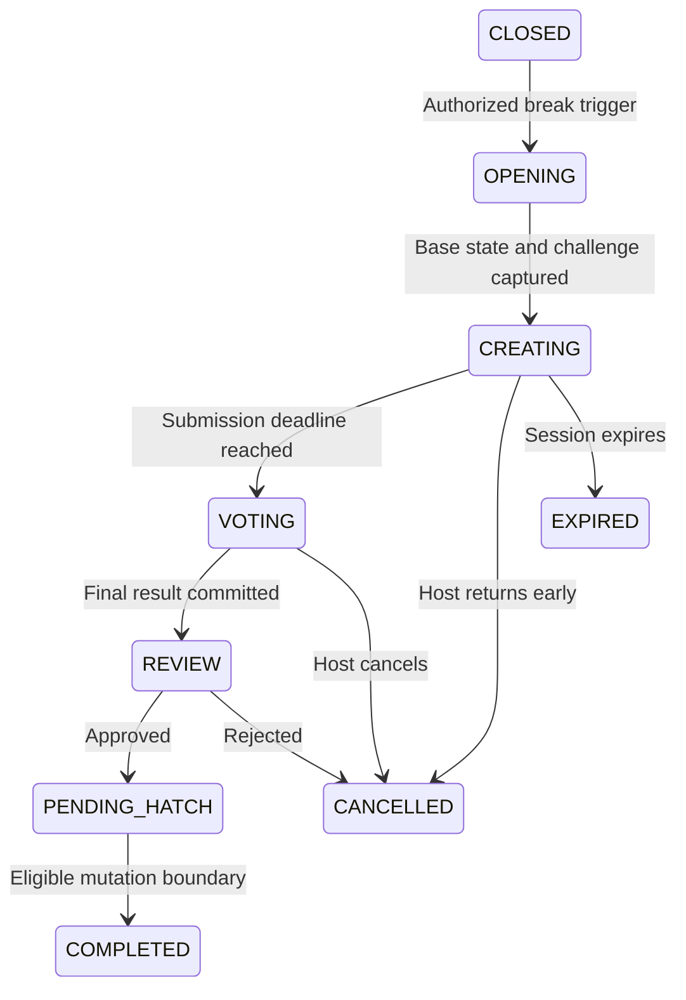
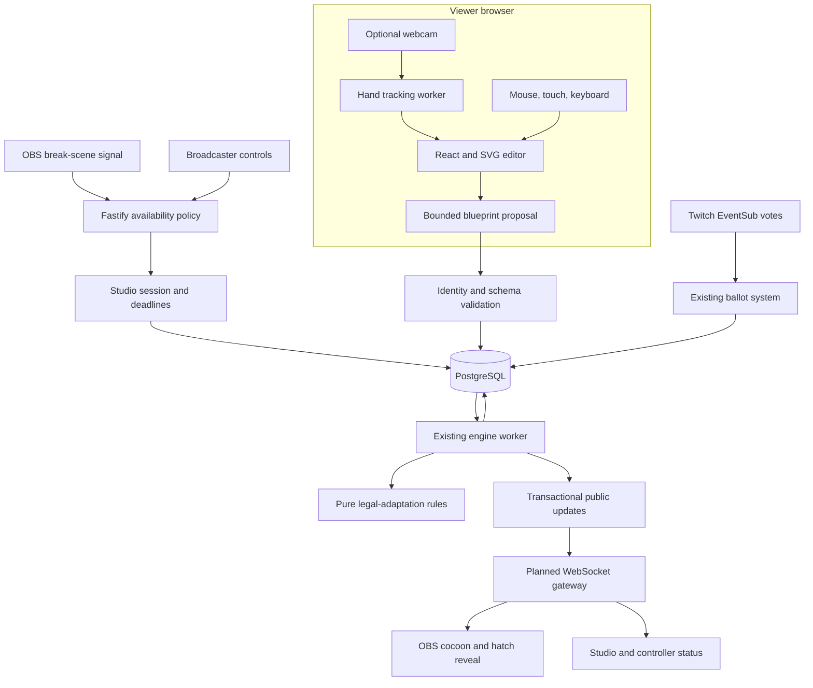
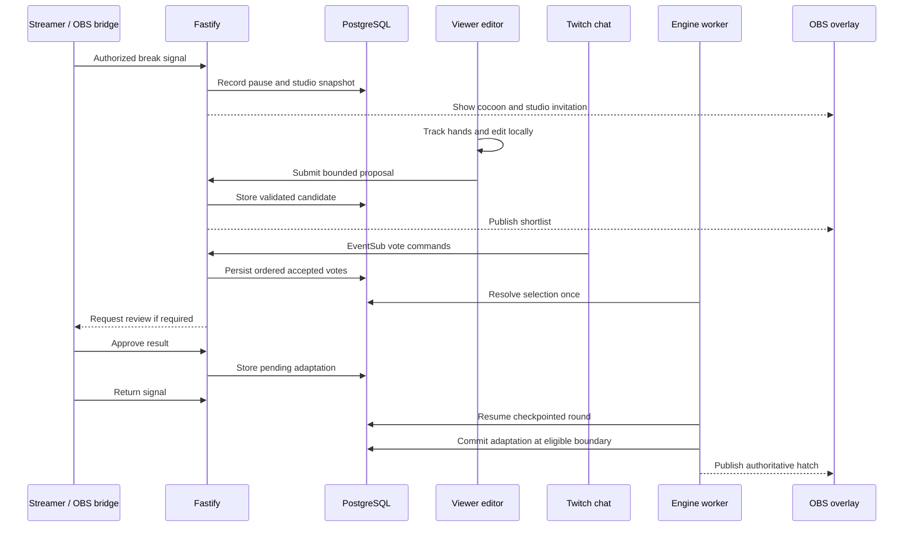

# Ripple: Cocoon Studio
## New feature specification and integration design

Version: 1.0
Status: Approved feature direction; implementation pending
Document type: Addendum to the existing Ripple PRD
Scope: Break detection, hand-controlled creation, community selection, and inherited character design

---

## 1. Updated product statement

Ripple turns a streamer's breaks into a community evolution studio.

Viewers shape a living creature with their hands, chat chooses its next adaptation, and raids carry that community's creation into other channels.

The original Ripple loop remains:

Seed -> Mutate -> Observe -> Survive -> Raid -> Inherit -> Leave a trace

Cocoon Studio adds a new participation path:

Break -> Sculpt -> Propose -> Vote -> Incubate -> Hatch -> Inherit

The studio produces adaptations that participate in Ripple's existing rules. It is not an independent character editor disconnected from the game.

---

## 2. Product purpose

When a streamer takes a break, viewers often lose their immediate shared activity.

Cocoon Studio gives the community a bounded creative task during that interval. The streamer returns to a visible result that continues into normal gameplay.

The feature must achieve four outcomes:

1. Give viewers something meaningful to create during a break.
2. Connect that creation to legal genetic trade-offs.
3. Preserve its community origin through future descendants.
4. Fit the existing application architecture without adding a video-processing backend.

The studio must remain optional for streamers. Ripple's normal gameplay must continue to work without cameras or studio participation.

---

## 3. Two additional sources of defensibility

These are advantages to build through execution and adoption, rather than barriers already established.

### 3.1 Gesture-to-evolution design system

Ripple converts imperfect hand movements into expressive, bounded, heritable character designs.

The accumulated system includes:

- Gesture mappings that work across supported devices.
- Anatomical templates that remain readable on stream.
- Geometry limits that prevent unusable designs.
- A deterministic mapping between adaptations and legal gene changes.
- Preview, voting, moderation, and inheritance behavior.
- Tested compatibility between appearance and gameplay rules.

MediaPipe supplies hand landmarks. Ripple supplies the design language and the rules that make those landmarks useful.

Improvement data should concern accepted designs, interaction completion, errors, and outcomes. Raw camera recordings are unnecessary.

### 3.2 Community-authored biological history

A character part gains meaning from the communities that created, adopted, modified, and carried it.

Examples:

- A shell was shaped during one community's break.
- Another community adopted its dormant variation.
- A descendant carried that shell through several habitats.
- Its success produced a shelter trace elsewhere.

This adds creative authorship to Ripple's existing lineage network.

The relevant accumulation is the shared history and approved design library, not a database of viewer biometrics.

---

## 4. Existing system baseline

The repository currently contains the foundation for:

- Node.js 24.
- TypeScript.
- Fastify.
- React and Vite.
- PostgreSQL 18.
- Drizzle migrations.
- Shared validation contracts.
- Docker Compose.
- Structured logs and health checks.

The existing delivery plan introduces the following in subsequent phases:

- Pure game engine.
- Ordered event intake.
- Durable deadlines.
- Transactional public updates.
- WebSocket delivery.
- Twitch authorization and EventSub.
- Raids and lineage.
- Habitat traces, dormant mutations, and ancestor trials.
- Full product surfaces.

This addendum extends those planned systems. It must not be described as functionality already implemented.

The infrastructure remains:

One TypeScript application service + PostgreSQL

---

## 5. Scope

### 5.1 Required for the first studio release

- Broadcaster-controlled studio enablement.
- Manual break activation.
- Configured OBS break-scene activation.
- Clear distinction between a break and an offline stream.
- A dedicated studio page in the existing web application.
- Optional browser-local webcam hand tracking.
- Mouse, touch, and keyboard alternatives.
- One editable shell component.
- One constrained decorative marking layer.
- Legal mutation templates supplied by the server.
- Personal proposals rather than unrestricted simultaneous editing.
- A bounded shortlist.
- Twitch chat voting.
- Broadcaster review or explicitly configured automatic approval.
- Pending adaptation committed at a safe game boundary.
- Appearance inheritance and provenance.
- Connections to dormant mutations, habitat traces, and ancestor trials.
- Replay, authorization, recovery, and acceptance tests.

### 5.2 Deferred expansion

- Additional anatomical editors for tendrils, travelling membranes, and other parts.
- Coordinated assembly by several simultaneous editors.
- Recorded motion signatures using bounded animation curves.
- Optional local presence analysis.
- Scheduled repeated studios during long unattended streams.
- Cross-channel design-library browsing.

These expansions must not delay proving the complete shell-creation-to-raid loop.

### 5.3 Outside this feature

- Unrestricted 3D modelling.
- Uploading viewer camera streams to Ripple.
- A server-side video-analysis service.
- Diagnosing sleep, fatigue, or other personal states.
- Arbitrary executable SVG or HTML uploads.
- Additional survival power purchased through paid events.
- Automatic changes to the Twitch broadcast or raid destination.

---

## 6. Core experience

### 6.1 Example

A streamer switches to their configured break scene.

Ripple shows:

"Your strain is entering its cocoon. Help shape its next shell."

A viewer opens the studio and enables their camera.

They pinch a shell control point, pull it outward, and select a permitted pattern.

The proposal shows:

Reinforce the shell
Grit +2
Pulse -2

Other participants create their own proposals.

Chat chooses between finalists and Keep current.

When the streamer returns, the selected design appears as a pending cocoon. It hatches at the next eligible mutation boundary.

The creature later produces a descendant through a real raid. That descendant inherits the approved design and its history.

### 6.2 Important distinction

The viewer's hand movement controls creative parameters.

The server controls:

- Which mutation templates are legal.
- The resulting gene changes.
- Which proposals are eligible.
- The voting result.
- When the adaptation becomes authoritative.

Drawing a larger shell must not produce unlimited Grit.

---

## 7. Availability and break detection

### 7.1 Availability is separate from broadcast status

Track these independently:

1. Twitch broadcast status.
2. Broadcaster availability.
3. Studio lifecycle.
4. Existing game-clock state.

A live stream can be in a break.

An offline stream is not an unattended studio.

Twitch's stream lifecycle events indicate broadcasting status; they do not establish that someone is sleeping or eating.

Reference:
https://dev.twitch.tv/docs/eventsub/eventsub-subscription-types/

### 7.2 Supported triggers

| Trigger | Initial behavior |
|---|---|
| Broadcaster selects Start break studio | Open according to configured policy |
| OBS switches to a configured break scene | Request studio activation |
| Broadcaster selects End break | Close creation and begin return handling |
| OBS switches back to a configured active scene | Request return handling |
| Twitch goes offline | Close active submission and pause |
| Integration state becomes unknown | Suspend automatic transitions and expose the problem |

### 7.3 OBS integration

Use the existing OBS browser-source environment to observe scene changes.

OBS browser bindings provide scene-change events and current-scene access subject to the applicable source permissions.

Reference:
https://github.com/obsproject/obs-browser#js-bindings

The integration must:

- Allow the broadcaster to identify break and active scenes.
- Reconcile the current scene when the source loads or reconnects.
- Test behavior when the browser source is hidden or shut down.
- Debounce scene changes.
- Ignore unrelated preview or scene activity.
- Retain manual controls as a fallback.

The hosted server does not need direct access to a local OBS WebSocket port.

### 7.4 Separate bridge authority

The ordinary overlay credential remains read-only.

If the OBS source reports availability, use a separate narrowly scoped bridge capability that can report availability signals for its configured channel.

It must not authorize:

- Editing genes.
- Approving designs.
- Changing health.
- Managing other channels.
- Reading Twitch credentials.

A bridge signal is a policy input, not proof of a human's physical state.

### 7.5 Optional future presence analysis

Local presence or activity analysis may suggest a break.

It must not independently label the streamer as sleeping or eating.

Automatic activation based on inferred activity requires separate broadcaster opt-in, conservative thresholds, a visible countdown, and an override.

This is not required for the first studio release.

---

## 8. State model

### 8.1 Broadcaster availability

- ACTIVE
- REST
- UNKNOWN

### 8.2 Studio lifecycle

- CLOSED
- OPENING
- CREATING
- VOTING
- REVIEW
- PENDING_HATCH
- COMPLETED
- CANCELLED
- EXPIRED

### 8.3 Main transitions



Offline status closes active creation and voting. Already accepted pending results remain subject to the explicit recovery policy below.

### 8.4 Authority

Transitions are server-authoritative and recorded.

A client-side timer, camera event, or scene event cannot directly commit a game change.

Each transition requires:

- Expected session version.
- Correct caller authority.
- Allowed current phase.
- An idempotency key where applicable.

---

## 9. Interaction with the existing game clock

A studio must not create an evolution-speed exploit.

### 9.1 On break entry

- Record the pause through the existing ordered command system.
- Checkpoint the current round and remaining active time.
- Preserve already committed mutations.
- Stop normal habitat observation during the studio.
- Exclude studio commands and creation activity from habitat fitness.

### 9.2 On return

Resume the existing round from its checkpoint.

Do not insert a new genotype into a partially observed round.

The selected studio adaptation waits until the next eligible mutation boundary.

At that boundary, it replaces the ordinary mutation choice for that slot.

### 9.3 Mutation allowance

A studio grants no additional mutation allowance.

Required rules:

- At most one pending genetic studio adaptation per organism.
- A pending adaptation targets one eligible future mutation slot.
- The same slot cannot receive both a studio adaptation and a normal mutation.
- Repeated break toggles cannot create extra genetic changes.
- Required intervening active observation cannot be skipped by entering another studio.

Cosmetic-only results still require selection and approval, but do not grant game power.

### 9.4 Incubation presentation

Before the eligible boundary, show:

"Community design selected. Hatches after the current round."

The preview must be visibly pending. It must not claim that health, protection, or genes have already changed.

---

## 10. Studio challenge and genetic mapping

### 10.1 Challenge creation

At studio opening, capture:

- Organism ID.
- Genome and version.
- Appearance blueprint and version.
- Ruleset version.
- Available legal mutation templates.
- Intended future mutation slot.

The initial editor focuses on shell adaptations.

Distinct legal trade-offs may include:

- Grit +2, Pulse -2.
- Grit +2, Drift -2.
- Grit +2, Calm -2.

Only currently legal directions may be offered.

### 10.2 Geometry within a legal adaptation

The selected mutation template defines:

- Allowed component type.
- Control-point limits.
- Minimum and maximum dimensions.
- Permitted curvature.
- Palette choices.
- Marking vocabulary.
- Renderer version.

Artists may vary the appearance within those bounds.

They may not change the gene delta through arbitrary geometry.

### 10.3 No legal shell mutation

If no functional shell mutation is legal:

- Offer a cosmetic-only studio, clearly labelled.
- Preserve the genome.
- Do not generate a dormant genetic mutation from cosmetic alternatives.
- Or let the broadcaster defer the workshop.

Do not bypass gene bounds to guarantee a mutation.

### 10.4 Final revalidation

Before commitment, revalidate against the actual current organism and ruleset.

If the base state has become incompatible, hold or reject the pending adaptation with a clear reason.

Never silently rebase an approved design into a different genetic cost.

---

## 11. Viewer creation experience

### 11.1 Entry

The OBS overlay and bot announcement provide a studio link.

The studio page shows:

- Current creature.
- Challenge and trade-offs.
- Time remaining.
- Hand-control option.
- Pointer-control alternative.
- Submission rules.
- Camera privacy statement.

The camera remains off until the viewer explicitly enables it.

### 11.2 Initial hand controls

| Gesture | Action |
|---|---|
| Pinch | Grab a permitted control point |
| Move while pinching | Adjust that point within bounds |
| Release pinch | Release the point |
| Two-hand separation | Adjust permitted shell scale |
| Tracking lost | Freeze editing until tracking recovers |

Submission requires an explicit confirmation control.

Tracking loss or an ambiguous gesture must never submit a proposal automatically.

### 11.3 Fallback controls

Mouse, touch, and keyboard operate the same parameters and limits.

Fallback users receive:

- The same mutation choices.
- The same submission eligibility.
- The same vote weight.
- The same possibility of winning.

Camera quality and gesture accuracy do not confer fitness advantages.

### 11.4 Calibration

Provide a short calibration:

- Mirrored preview.
- Hand detection indicator.
- Pinch demonstration.
- Sensitivity adjustment.
- One-hand mode.
- Reset and undo.

Use smoothing, dead zones, and confidence checks to reduce jitter.

Tracking parameters require testing on supported devices; they are not biological measurements.

---

## 12. Proposal and selection rules

### 12.1 Personal proposals

Participants edit their own drafts.

There is no unrestricted shared authoritative mesh.

This avoids conflicting continuous edits and keeps the live creature stable.

### 12.2 Authorship

Anyone may experiment locally.

Submitting an attributable proposal requires a verified Twitch artist identity.

Use a separate artist role within the planned authentication system.

Artist sign-in must not request broadcaster, bot-management, or paid-event permissions.

Voting continues through ordinary Twitch chat without a separate Ripple registration.

### 12.3 Submission limits

Initial configurable limits:

- One active submitted proposal per artist per studio.
- Replacement permitted before the submission deadline.
- Bounded replacement frequency.
- Bounded total accepted submissions per studio.
- Maximum blueprint payload size.
- No submissions outside the CREATING phase.

When a capacity limit is reached, explain it explicitly.

Local editing may continue without promising server acceptance.

### 12.4 Shortlisting

The initial selection method should be deterministic and inspectable:

- Validate every eligible submission.
- Prefer different legal mutation directions when available.
- Use a recorded seeded selection among equivalent eligible proposals.
- Allow at most two finalists.
- Include Keep current as the remaining choice.

Do not rank artists by spending, camera quality, or inferred physical performance.

Broadcasters can remove an inappropriate proposal through an explicit moderation action.

### 12.5 Final vote

Use the existing chat ballot system:

- `!ripple 1`
- `!ripple 2`
- `!ripple 3`

Reuse:

- One accepted vote per account.
- Recorded deadlines and close markers.
- Deterministic tie handling.
- Shared Chat locality.
- Duplicate delivery protection.

Keep current is the no-vote default.

If there are fewer finalists, show only the valid options.

### 12.6 Ballot arbitration

A studio vote must not overlap another channel-wide Ripple ballot.

Opening a studio pauses or queues normal ballot work according to the existing round checkpoint.

Welcome and other queued gameplay decisions remain recorded and resume in the documented order.

---

## 13. Review and hatching

### 13.1 Default approval policy

The initial default is broadcaster review.

The creator returns to:

- Winning design.
- Genetic trade-off.
- Community attribution.
- Approve.
- Keep current.

The pending result has a finite review lifetime.

### 13.2 Optional automatic approval

A broadcaster may explicitly enable automatic approval for restricted templates.

Automatic approval requires:

- Allowed geometry only.
- Legal mutation only.
- Valid current base state.
- No arbitrary uploads or text rendering.
- An available mutation slot.
- All normal caps and rate limits.

Unattended studios do not imply unrestricted editing authority.

### 13.3 Atomic commitment

At the eligible boundary, one transaction must:

1. Verify the pending adaptation remains eligible.
2. Check the expected organism version.
3. Consume the intended mutation slot.
4. Apply the legal gene change, if any.
5. Set the immutable appearance blueprint reference.
6. Append provenance and game events.
7. Mark the pending adaptation committed.
8. Insert public updates.
9. Commit.

Only after commitment does the authoritative hatch animation publish.

A retried job must not apply the genes twice.

---

## 14. Integration with existing Ripple mechanics

### 14.1 Raids and offspring

A child inherits the parent's latest committed appearance blueprint and genome.

It does not inherit an unapproved or pending studio draft.

Existing children remain unchanged when their parent later hatches a new design.

### 14.2 Passport and appearance

Extend the passport with:

- Studio of origin.
- Creating channel.
- Accepted blueprint.
- Mutation trade-off.
- Parent blueprint reference.
- Modification history.
- Optional author credit.

Keep the existing visual ancestry limits. Full provenance can remain available in the passport even when only a few marks are visible on the creature.

### 14.3 Dormant mutations

A qualifying losing finalist may attach its blueprint to a dormant mutation.

Existing vote thresholds still apply.

Before future expression:

- Rebase the genetic direction legally.
- Revalidate the visual template.
- Check the relevant renderer/rules version.
- Ask the receiving community to choose it.

If its gene direction is equivalent to the winning direction, preserve the losing art in history rather than pretending it is a distinct dormant genetic alternative.

Cosmetic-only proposals do not create dormant genes.

### 14.4 Habitat traces

A hand-shaped shell can provide visual provenance for an eventual shelter trace.

Trace qualification still requires the existing valid survival rounds.

Studio participation itself:

- Does not count as habitat activity.
- Does not earn survival rounds.
- Does not immediately produce a trace.
- Does not increase trace power.

### 14.5 Ancestor trials

Render the ancestral and current designs beside their existing score comparison.

The comparison uses matched game inputs.

Appearance alone must not change the score unless its approved mutation changed the genome.

### 14.6 Fossils

A failed branch retains the appearance blueprint it actually used.

Later renderer changes must not silently rewrite its historical identity.

---

## 15. Architecture

### 15.1 Infrastructure

Retain:

- React/Vite web application.
- Fastify application service.
- PostgreSQL.
- Drizzle.
- Shared Zod contracts.
- Pure engine package.
- Ordered inbox.
- Durable deadlines.
- Transactional public updates.
- Planned WebSocket gateway.
- SVG rendering.

Add MediaPipe Hand Landmarker to the web application.

No Python service, GPU server, video relay, or additional database is required.

### 15.2 System diagram



The engine worker owns persistence.

Pure rules receive explicit state and commands and perform no camera, network, or database operations.

---

## 16. Browser-local computer vision

### 16.1 Library

Use:

`@mediapipe/tasks-vision`

Hand Landmarker provides hand landmarks for the gesture interpreter.

Reference:
https://developers.google.com/edge/mediapipe/solutions/vision/hand_landmarker/web_js

### 16.2 Processing pipeline

1. Viewer enables camera.
2. Browser acquires a video-only media stream.
3. Frames are sampled at a bounded adaptive rate.
4. A worker performs hand-landmark detection where supported.
5. A gesture interpreter produces editor actions.
6. Actions modify a local bounded preview.
7. Only an explicitly submitted blueprint is sent to Ripple.

Detection calls can block the UI thread, so worker compatibility must be tested early.

Do not accumulate a queue of stale frames. Prefer the newest available frame.

### 16.3 Camera requirements

Use HTTPS in production and an appropriate local development context.

Request video only. Do not request microphone access.

Reference:
https://developer.mozilla.org/en-US/docs/Web/API/MediaDevices/getUserMedia

Stop camera tracks when:

- The viewer disables the camera.
- The editor closes.
- The session expires.
- The user exits the studio.

Pause unnecessary processing when the page is hidden.

### 16.4 Assets

Pin compatible library and model versions.

Serve reviewed model/WASM assets through the application's static-asset path where appropriate.

Load vision assets when opening the studio, not on every ordinary overlay visit.

Record applicable package/model notices in the dependency inventory.

### 16.5 Failure behavior

If camera access, model loading, or worker execution fails:

- Keep the draft.
- Explain the failure.
- Offer pointer controls.
- Do not prevent chat voting.
- Do not repeatedly prompt for camera permission.

---

## 17. Blueprint contract

The server accepts a declarative specification, not arbitrary SVG.

Illustrative structure:

```json
{
  "schemaVersion": 1,
  "studioSessionId": "uuid",
  "baseOrganismId": "uuid",
  "baseOrganismVersion": 17,
  "mutationTemplateId": "grit-plus2-pulse-minus2",
  "rendererVersion": "shell-v1",
  "part": {
    "type": "shell",
    "templateId": "segmented-shell",
    "parameters": {
      "width": 620,
      "height": 440,
      "curvature": 300
    },
    "marking": {
      "patternId": "bands",
      "paletteId": "teal-amber"
    }
  }
}
```

Parameter values use bounded normalized integers.

The server must validate:

- Session and world.
- Artist identity and ownership.
- Base organism/version.
- Allowed template.
- Legal mutation direction.
- Parameter ranges.
- Permitted marking/palette.
- Payload size.
- Submission phase.
- Rate limits.

The client does not supply authoritative resulting genes, health, score, or identity.

The server generates canonical JSON and its blueprint hash.

A stored blueprint is immutable after acceptance.

---

## 18. Data model additions

Prefer extending existing entities where their semantics already fit.

| Entity | Purpose |
|---|---|
| studio_sessions | Lifecycle, base state, challenge, deadlines, approval policy, winner, intended mutation slot |
| studio_proposals | Artist ownership, blueprint candidate, revision, validation and eligibility |
| appearance_blueprints | Immutable canonical design, renderer version, hash and parent reference |
| artist_sessions | Identity-only author sessions separated from broadcaster control |
| studio_bridge_capabilities | Narrow channel-specific availability reporting |
| pending_adaptations | Approved result waiting for a safe mutation boundary |

Existing entities gain:

| Existing entity | Addition |
|---|---|
| channels/settings | Studio enablement, break-scene mapping, approval and timeout policies |
| organisms | Current appearance blueprint reference |
| rounds/ballots | STUDIO_SELECTION ballot kind |
| votes | Reuse existing uniqueness and acceptance rules |
| dormant mutations | Optional approved blueprint reference |
| game events | Studio, approval, blueprint and commitment events |
| deadlines | Creation close, voting close, review expiry and hatch eligibility |
| public updates | Studio lifecycle and hatch messages |
| passports/projections | Component provenance and modification history |

Some projections may be derived from game events instead of requiring separate physical tables.

Required constraints:

- One nonterminal studio per channel.
- One active submitted proposal per artist/session.
- One pending genetic adaptation per organism.
- One commitment per targeted mutation slot.
- Immutable accepted blueprint content.
- Strict world isolation.

---

## 19. API additions

These are proposed routes for integration into the existing server.

| Route | Authority | Purpose |
|---|---|---|
| POST /api/channels/:id/studio/start | Broadcaster session | Start an enabled studio |
| POST /api/channels/:id/studio/stop | Broadcaster session | End or cancel creation |
| POST /api/channels/:id/availability | Broadcaster or scoped bridge | Report an allowed availability signal |
| GET /api/studios/:id | Appropriate read access | Studio state and legal challenge |
| GET /auth/twitch/artist/start | Purpose-bound OAuth flow | Begin artist sign-in |
| POST /api/studios/:id/proposals | Artist session | Submit or replace owned proposal |
| DELETE /api/studios/:id/proposals/:proposalId | Owning artist | Withdraw before closure |
| POST /api/studios/:id/review | Broadcaster session | Approve or reject selected result |
| GET /api/blueprints/:id | Appropriate read access | Retrieve safe declarative design |

Use:

- Ownership checks.
- CSRF protection for cookie-authenticated writes.
- Expected versions.
- Idempotency keys.
- Stable error codes.
- Shared schemas.

Examples:

- STUDIO_DISABLED
- STUDIO_WRONG_PHASE
- BASE_STATE_CHANGED
- MUTATION_NOT_LEGAL
- PROPOSAL_LIMIT_REACHED
- PENDING_ADAPTATION_EXISTS
- REVIEW_EXPIRED

Live selection votes continue to arrive through authenticated Twitch EventSub.

A browser endpoint must not impersonate arbitrary Twitch voters.

---

## 20. Public events and WebSocket behavior

Reuse the planned versioned update envelope.

Add event types:

- availability.changed
- studio.opened
- studio.phase_changed
- studio.shortlist_ready
- studio.selection_resolved
- studio.review_required
- studio.adaptation_pending
- appearance.committed
- studio.completed
- studio.cancelled

Public payloads contain safe studio and design state.

They do not contain:

- Camera frames.
- Raw landmark streams.
- OAuth tokens.
- Private artist-session credentials.

Editing previews remain local in the first release.

The server broadcasts selected candidates and committed results, not every hand movement.

Reconnect uses the existing snapshot/version mechanism.

---

## 21. End-to-end authoritative flow



The architecture preserves the separation between:

- Creative input.
- Community choice.
- Broadcaster authority.
- Deterministic game commitment.

---

## 22. Failure and edge-case handling

| Situation | Required behavior |
|---|---|
| Streamer returns during creation | Stop accepting new work; default to preserving drafts without applying them |
| Streamer returns during voting | Follow configured finish/cancel policy; never fabricate a result |
| Stream goes offline | Close active input and pause; preserve accepted state for explicit recovery |
| OBS bridge disappears | Mark availability signal stale; do not infer that the streamer returned |
| Viewer loses hand tracking | Freeze local edit; retain pointer fallback |
| Viewer loses network | Preserve local draft; resubmit only if the session remains open |
| No eligible proposals | Resolve to Keep current |
| No valid votes | Resolve to Keep current |
| Winner is rejected | Preserve actual game state and record rejection |
| Pending result expires | Release its reservation and record expiry |
| Organism becomes a fossil | Cancel pending adaptation |
| Genome/version changes incompatibly | Require revalidation; do not apply a different cost silently |
| Raid occurs before hatch | Child inherits the previously committed appearance |
| Duplicate commit job | Return the existing commitment without repeating the mutation |
| Server restarts | Recover session/deadline state from PostgreSQL |
| Unsupported renderer version | Hold/reject with an explicit compatibility error |
| Camera permission denied | Continue with equivalent non-camera controls |

Avoid silently losing accepted results or presenting a pending design as already inherited.

---

## 23. Replay and determinism

Computer vision output is not assumed deterministic across devices.

Replay therefore uses:

- Accepted blueprint.
- Canonical blueprint hash.
- Mutation template and rules version.
- Base organism version.
- Final ballot result.
- Approval event.
- Target mutation slot.
- Commitment event.
- Renderer version.

Replay does not require camera recordings or repeated landmark inference.

Historical design rendering must retain compatible renderer/template versions.

Counterfactual replay may compare a rejected legal proposal using the existing fixed-input rules, but it cannot rewrite the canonical lineage.

---

## 24. Privacy and moderation

### 24.1 Privacy

- Camera access is opt-in.
- Video stays in the browser.
- No microphone is required.
- Raw hand landmarks are not stored server-side.
- Store approved design parameters and necessary provenance.
- Individual author credit is opt-in.
- Channel-level credit is the default public attribution.
- Apply documented retention and deletion policies to identity-linked records.

### 24.2 Moderation

- Render approved templates only.
- Accept bounded parameters, not executable assets.
- Constrain markings and palettes.
- Do not render arbitrary submitted text.
- Allow broadcaster rejection and source/artist blocking.
- Rate-limit submission and replacement.

An unattended studio should use restricted automatic-approval settings or wait for review.

### 24.3 Client trust

A submitted blueprint is untrusted input.

The server cannot prove that the creator used hand controls rather than another client.

Do not grant prizes, extra gene power, or privileged votes based on claimed gesture performance.

---

## 25. Changes by existing package

### apps/web

Add:

- Studio route.
- Artist sign-in entry.
- Camera permission and calibration UI.
- Hand-tracking worker.
- Gesture interpreter.
- Shared pointer-accessible editor.
- Local preview and undo.
- Submission/selection/review states.
- Cocoon and hatch presentation.

### apps/server

Add:

- Availability policy.
- Scoped OBS bridge reporting.
- Studio lifecycle handlers.
- Artist identity/session handling.
- Proposal validation.
- Review and pending-adaptation endpoints.
- Studio deadline jobs.
- Public update production.

### packages/contracts

Add schemas for:

- Availability signals.
- Studio sessions and phases.
- Legal challenge templates.
- Blueprint parameters.
- Submission/review commands.
- Public studio events.

### packages/engine

Add pure functions for:

- Studio eligibility.
- Blueprint-template compatibility.
- Pending-adaptation legality.
- Mutation-slot consumption.
- Blueprint inheritance.
- Dormant blueprint compatibility.

Camera and gesture code must not enter the engine.

### packages/database

Add migrations, constraints and queries for the studio entities.

Reuse existing transaction, deadline, inbox and public-update conventions.

### Simulator and tests

Add scenarios for:

- Repeated break toggles.
- Pending adaptation conflicts.
- Studio selection and dormant capture.
- Appearance inheritance.
- Zero gameplay benefit from cosmetic-only designs.
- Restart and duplicate commitment.

---

## 26. Deployment and operational changes

The deployment topology remains unchanged.

Additional work:

- Bundle or serve pinned vision/model assets.
- Configure appropriate asset MIME types.
- Test worker/WASM behavior under the existing security headers.
- Permit camera access on the studio surface without enabling unnecessary microphone access.
- Review Content Security Policy changes narrowly.
- Include third-party notices.
- Add studio feature flags and resource limits.
- Add database migrations.
- Add model-loading and camera-support diagnostics.

No OpenAI inference key is needed for the studio.

Local hand tracking introduces runtime computer vision; it does not introduce a runtime LLM or cloud inference requirement.

---

## 27. Performance requirements

Treat these as targets to measure, not achieved results.

- Editing must remain responsive while inference runs.
- Frame processing must use bounded backpressure.
- Hidden tabs should avoid unnecessary inference.
- Draft updates should not generate continuous server traffic.
- Submissions must have strict size and frequency limits.
- Public updates should scale with studio state and voting aggregates, not camera frame rate.
- Existing live event processing must remain responsive during many simultaneous studios.

Test:

- Low-end supported laptops.
- Camera denied/unavailable.
- One-hand and two-hand use.
- Model download failure.
- Slow networks.
- Many artists in one session.
- Many studio sessions across channels.
- Reconnect during voting and hatching.

Measure client performance separately from server callback latency.

---

## 28. Analytics

Add minimal events:

- studio_triggered
- studio_opened
- editor_opened
- camera_enabled
- camera_failed
- fallback_selected
- proposal_submitted
- shortlist_published
- studio_vote_accepted
- proposal_approved
- proposal_rejected
- adaptation_hatched
- inherited_blueprint_seen

Useful metrics:

- Studio participation.
- Editor-to-submission completion.
- Camera versus fallback completion.
- Selection participation.
- Approval rate.
- Successful hatch rate.
- Reuse through descendants.
- Return use by broadcasters.

These metrics do not prove viewer watch-time retention.

Do not collect raw video to calculate them.

---

## 29. Acceptance criteria

### Availability

- Explicit controls work without OBS automation.
- Configured break scenes trigger only enabled channels.
- Reconnection reconciles scene state.
- Offline and unknown states are handled separately.
- Ordinary overlay credentials cannot control the studio.

### Editor

- Hand and pointer controls operate identical bounded parameters.
- Tracking loss does not submit or corrupt a proposal.
- Camera denial leaves a usable experience.
- Video and raw landmarks never enter normal server requests.
- Submitted designs cannot inject executable SVG/HTML.

### Gameplay

- Gene budget remains conserved.
- Cosmetic-only designs cannot change fitness.
- Studio and normal mutations cannot consume the same slot twice.
- Repeated breaks do not accelerate genetic progression.
- Pending designs do not affect existing rounds or descendants.
- Accepted designs inherit only after commitment.

### Existing mechanics

- Dormant candidates obey existing thresholds and legality.
- Trace qualification still requires real valid survival rounds.
- Ancestor trials remain side-effect free.
- Fossils preserve the correct historical design.
- Replays reproduce appearance and game state from accepted records.

### Reliability

- Duplicate votes, approvals, deadlines and commits are harmless.
- Restarts recover the correct phase and deadlines.
- Reconnect retrieves current authoritative state.
- Sandbox studio controls cannot affect live worlds.
- Unsupported model/renderer states fail visibly.

---

## 30. Implementation sequence

Respect the existing phased delivery plan.

### Step 1: Technical editor spike

Build a local shell editor with:

- One template.
- Pinch-and-drag.
- Two-hand scaling.
- Pointer fallback.
- No authoritative game writes.

Prove browser, worker and model compatibility.

### Step 2: Pure blueprint contracts

Define legal parameters, mutation mappings, canonical serialization and renderer versions.

Add property tests before connecting to live state.

### Step 3: Studio persistence and lifecycle

After the ordered event/deadline backbone exists, implement sessions, proposals, permissions and recovery.

### Step 4: Twitch identity and voting

Reuse the planned authentication and ballot systems.

Preserve the ordinary chat-voter experience.

### Step 5: Safe genetic commitment

Integrate pending adaptations with the engine and mutation-slot rules.

Verify pause/resume and duplicate-commit behavior.

### Step 6: Inheritance connections

Connect appearance to offspring, passports, dormant candidates, traces and ancestor views.

### Step 7: OBS automation

Add configured scene detection and reconcile source lifecycle behavior.

Retain manual controls.

### Step 8: Full rehearsal

Demonstrate:

Break -> Hand-built proposal -> Chat selection -> Approval -> Hatch -> Real raid -> Inherited design

Label sandbox and accelerated footage clearly.

---

## 31. Demo scenario

1. The streamer switches to a configured break scene.
2. Ripple opens Cocoon Studio.
3. A viewer shapes a shell using hand gestures.
4. Another participant uses pointer controls.
5. Chat selects a proposal with a visible genetic cost.
6. The streamer returns and approves it.
7. The adaptation hatches at the eligible boundary.
8. A real raid creates a descendant with the design.
9. The receiving community sees its origin.
10. An ancestor comparison shows the genetic trade-off under matched inputs.

The scenario demonstrates the full integration rather than only a webcam-controlled shape.

---

## 32. Release boundary

The first complete studio release delivers:

- Reliable break activation.
- Browser-local hand-controlled creation.
- Equal non-camera participation.
- Bounded community proposals.
- Twitch chat selection.
- Safe approval and genetic commitment.
- Inherited appearance and provenance.
- Integration with existing lineage mechanics.
- Deterministic history and recovery.

Ripple's original evolution system remains the foundation.

Cocoon Studio adds a new way for communities to create something that matters within that system.