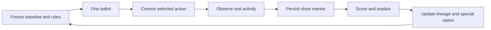
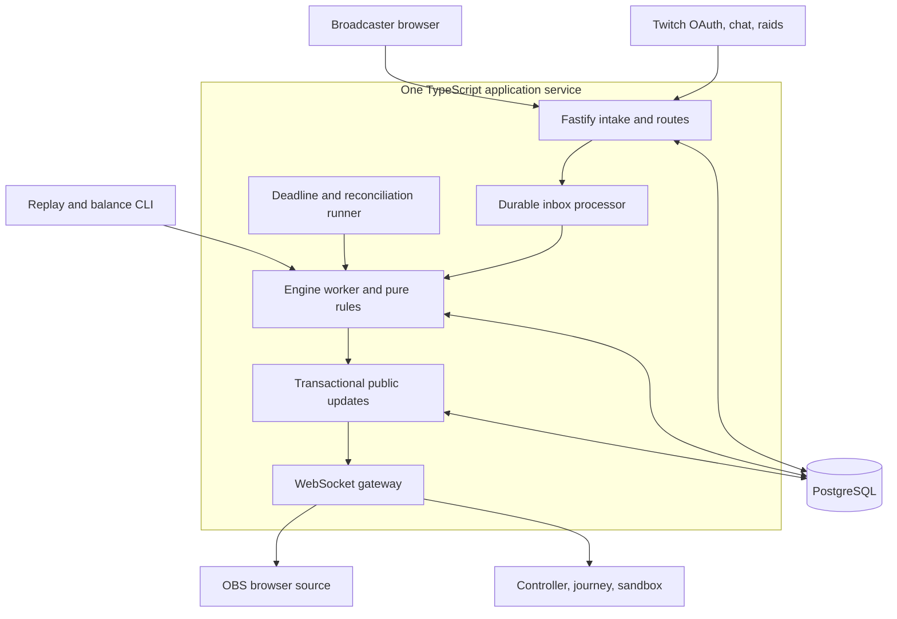

# RIPPLE

## Product requirements and technical design

Version 1.0 | 27 October 2026 | Approved feature direction; implementation specification

**Pitch:** Communities shape living strains. Raids carry their descendants. Every host changes the lineage, and successful visitors leave a trace for those who follow.

**Document status:** This is the consolidated pre-release specification. No application, integration, balance result, or capacity benchmark is represented as completed. This document supersedes [the earlier blueprint](archive/ripple-blueprint.md) for implementation decisions. Numerical game parameters are initial, versioned balance candidates; they require the simulator and release checks described below.

## Contents

1. Product intent and differentiation
2. Users, platforms, and outcomes
3. Final scope and resolved decisions
4. Complete feature register
5. Product journeys and system flow
6. Game model and deterministic rules
7. Habitat traces
8. Dormant mutations
9. Live ancestor trials and explanations
10. Raids, welcome, shelter, and lineage
11. Interaction and visual design
12. Architecture and technology stack
13. Twitch integration and authorization
14. Event ordering, transactions, and recovery
15. Data model and invariants
16. API and real-time contracts
17. Privacy, security, and moderation
18. Deployment, installation, and operations
19. Performance and scaling
20. Analytics and product validation
21. Verification and release acceptance
22. Codex development and balance evidence
23. Delivery plan and judging package
24. Risks and deferred roadmap
25. Coverage, sources, and glossary

## 1. Product intent and differentiation

Ripple is a Twitch-connected, deterministic evolution game shared by streamers and their communities. Chat makes bounded mutation decisions. The channel's observed activity creates selection pressure. An actual raid branches a descendant into another authorized host, where the receiving community shapes its next adaptation.

The product solves three related needs: streamers want a lightweight shared activity during existing raids; viewers want choices with visible consequences; collaborating creators want a continuing story that can span their separate broadcasts.

The central loop is **seed -> choose -> observe -> adapt -> raid -> welcome -> inherit -> leave a trace**. A strain is a shared community organism with a genome and history. It is not individually owned by every viewer.

Ripple's distinctiveness comes from the combination of environmental selection, inherited community decisions, dormant minority-backed options, temporary habitat traces, and live comparisons with ancestral genomes. The targeted prior-art review found that [StreamRaid](https://devpost.com/software/streamraid) describes travelling viewer pets and clicker combat; this is a product comparison, not proof of global originality. Competition in Ripple uses environmental fitness, with no click-to-damage combat requirement.

The experience must remain readable during a stream. The creature provides personality; three concise cards communicate the current decision; a short result explains what changed. The lineage page provides depth without occupying the broadcast permanently.

## 2. Users, platforms, and outcomes

| User | Need | Success observation |
| --- | --- | --- |
| Broadcaster | Connect quickly, control incoming activity, preserve attention for the stream | A visible creature and verified connection without local backend setup |
| Viewer | Contribute through ordinary Twitch chat and understand consequences | An accepted vote, visible adaptation, and explanation |
| Receiving community | Have agency over an incoming descendant | Complete a welcome choice and recognize the visitor's origin |
| Returning community | See whether its contribution mattered elsewhere | Inspect descendant updates and inherited marks |
| Judge | Test the complete loop without accounts or several live channels | Complete an isolated sandbox expedition and replay |
| Maintainer | Diagnose failures and reproduce outcomes | Correlated logs, deterministic fixtures, and clean installation |

Initial supported target for release testing: current Chrome and Edge on Windows, OBS Studio browser source on Windows, and a Linux-container server. Docker Compose supports local evaluation on a Docker-capable machine. Other browsers and OBS desktop platforms are compatibility targets until separately tested. OBS supports URL-based browser sources; actual Ripple compatibility still requires testing. [OBS Browser Source](https://obsproject.com/kb/browser-source).

Product targets, to validate rather than advertise as achieved: first visible sandbox action within one minute; first broadcaster creature within five minutes after grants and callback setup; an understandable mutation choice without reading the technical genome table; and a complete judge journey within three minutes.

## 3. Final scope and resolved decisions

The user's accepted scope includes all three new proposals and everything previously designated first release, optional first release, after basic voting/branching, or stretch. Those items are required before this release is declared complete. Ideas explicitly designated later remain documented in section 24.

| Decision | Final pre-release rule |
| --- | --- |
| Transfer or branching | A real raid creates one descendant; the source parent remains |
| Initial genes | Pulse, Calm, Grit, Drift; total budget 24; each integer 0-15 |
| Eight original gene names | Preserved in the decision history; not a second simultaneously active ruleset |
| Paid events | Optional visual celebrations; no survival advantage or extra vote weight |
| Default participation | Free chat commands; no separate viewer registration |
| Competition | One resident plus at most one active visitor; bounded shelter can defer one contest |
| Extinction | A failed branch becomes a fossil; its history and other living relatives persist |
| Novel mechanics | Habitat traces, dormant mutations, and live ancestor trials are required |
| Source preparation | Included as an optional-to-use queued ballot, implemented before release |
| Stretch features | Basic shelter and rejected-option replay are included before release |
| Runtime generation | Authored visuals and deterministic templates; no runtime LLM dependency |
| Deployable backend | One TypeScript application plus PostgreSQL |
| Judge access | Keyless isolated sandbox, authentic Twitch evidence, and reproducible local setup |

Scope is final for this PRD. Optional-to-use means the implementation exists but a broadcaster need not enable it. A feature cannot quietly become a release cut because it was previously labeled stretch. A change to this baseline requires an explicit scope revision.

## 4. Complete feature register

Every P identifier below is a pre-release requirement. Numerical details are configurable, but the behavior and acceptance obligations remain required.

| ID | Feature | Required behavior |
| --- | --- | --- |
| P01 | Channel onboarding | Broadcaster OAuth, opt-in settings, subscription readiness, and overlay setup |
| P02 | Strain seeding | Name a founding strain, initialize legal genes and health, record origin |
| P03 | Genome and budget | Four bounded genes with conserved budget and reproducible mutation generation |
| P04 | Mutation voting | Three cards, one vote per account per ballot, deterministic ties and no-vote default |
| P05 | Real habitats | Capped chat-derived activity, temporal profile, category transitions, and frozen channel baseline |
| P06 | Fitness and survival | Integer scoring, bounded health, shock/upkeep, genuine branch extinction |
| P07 | Raid offspring | One idempotent child per eligible raid; preserve parent and ancestry |
| P08 | Preparation | Queue a standing travel trade-off without delaying a Twitch raid |
| P09 | Welcome | Receiving chat chooses arrival behavior at a safe round boundary |
| P10 | Admission and harbor | Accept, decline, defer, expire, and cap visitors; handle unknown destinations |
| P11 | Ecological contest | Score resident and visitor under the same observed round; apply explicit tie rule |
| P12 | Shelter | Bounded resident-to-visitor energy transfer; defer competition for one round |
| P13 | Passport | Origin, parents, hosts, adaptations, trace emissions, and current branch status |
| P14 | Inherited appearance | One origin mark, at most two ancestry marks, and gene-linked authored parts |
| P15 | Descendant updates | Show a compact family update when the source returns |
| P16 | Fossils | Preserve failed branch history and appearance without free resurrection |
| P17 | Lineage map | Multiple seeded lineages, branching, host locations, traces, and fossils |
| P18 | Outcome explanation | Exact score contributions and two principal causes in viewer language |
| P19 | Choice preview | Recent-profile estimate, explicit uncertainty, and displayed trade-off |
| P20 | Alternative replay | Evaluate rejected candidates against fixed recorded round inputs |
| P21 | Habitat traces | Earn, offer, approve/clear, apply, attribute, and expire one temporary trace per host |
| P22 | Dormant mutations | Preserve one qualified runner-up and re-offer a legal option in a suitable future habitat |
| P23 | Ancestor trials | Score a founding genome under matched current conditions; shadow has no game effects |
| P24 | Single-channel loop | Useful voting/adaptation without another enrolled channel |
| P25 | Offline and outage handling | Pause active clocks; distinguish real inactivity from unavailable input |
| P26 | OBS overlay | Transparent, readable, responsive creature and decision presentation |
| P27 | Streamer controls | Pause/resume, admission policy, ballot scheduling, names, and display preferences |
| P28 | Event history and replay | Versioned commands, seeds, lineage checksum, and reproducible reconstruction |
| P29 | Sandbox | Separate world per judge; vote, raid, change habitat, inspect, replay, and reset |
| P30 | Installation | One-command Compose startup with migrations and sandbox fixtures |
| P31 | Reliable intake | Signed webhooks, durable inbox, deduplication, ordering, and subscription recovery |
| P32 | Browser recovery | Snapshot-first connection, version checking, bounded fan-out, reconnect catch-up |
| P33 | Simulator | Reproducible channel scenarios and adversarial policy comparisons |
| P34 | Codex evidence | Actual prompts/session reference, code changes, and before/after measurements |
| P35 | Optional celebrations | Authorized eligible paid-event effects, capped and independent of fitness |
| P36 | Abuse resistance | Account-level vote uniqueness, capped activity, Shared Chat locality, and raid-loop limits |
| P37 | Operational readiness | Health checks, correlated logs, backups, restore rehearsal, and feature flags |
| P38 | Accessible design | Text plus color, reduced motion, readable countdowns, and keyboard-accessible controls |
| P39 | Basic analytics | First creature, accepted votes, successful admissions, welcome completion, and return use |
| P40 | Submission package | Working Twitch footage, code/assets/run instructions, Codex evidence, and judge access |

All original concept capabilities have a disposition: the core remains; gene count, raid movement, paid fitness, and unconditional loser deletion are revised explicitly; native polls, Extensions, hybridization, niches, and long-term expeditions are retained in the roadmap.

## 5. Product journeys and system flow

### 5.1 Broadcaster onboarding

Open Ripple -> connect broadcaster account -> authorize required grants -> choose visitor policy -> subscription check -> seed/name strain -> copy read-only overlay URL -> paste into OBS -> confirm a renderer heartbeat and preview. The controller distinguishes authorized, callback ready, subscriptions enabled, stream offline, and overlay not yet connected.

If a grant or callback is missing, show the exact failed step and a retry action. Do not present a successful game connection based only on the OAuth redirect. Bot authorization is an operator setup step, not repeated for every viewer.

### 5.2 Normal channel round

At a safe boundary, freeze rules and baseline -> select one ballot -> open voting -> commit its result -> observe the real channel -> close at a durable marker -> score the strain(s) -> explain results -> update passport/map -> expire or queue special effects -> open the next round. Only one gameplay ballot is open in a channel at a time.



### 5.3 Raid and arrival

An enrolled source raids -> signed event accepted once -> source state identified in command order -> source and destination checked -> child snapshot and transfer committed -> source parent retained -> destination arrival shown -> wait for safe welcome slot -> receiving vote -> observe acclimatization/contest -> resolve -> continue adaptation.

Offline, full, or approval-required destinations enter a bounded harbor state. An unregistered destination receives no active organism or unsolicited automated message. The source may copy an invite; a later adoption is clearly labeled as arising from an earlier raid.

### 5.4 End of stream and return

Stream offline -> stop active-time deadlines with a recorded pause -> retain state -> show no ongoing decay. On return, reconcile Twitch state and subscriptions -> verify current ruleset -> show descendant updates -> resume or reopen the interrupted round according to the recorded recovery policy. Parent persistence does not depend on the OBS tab remaining connected.

### 5.5 Judge journey

Try sandbox -> isolated synthetic world -> choose mutation -> advance observation -> simulated raid -> welcome -> reveal dormant choice or trace -> compare ancestor -> inspect lineage -> reset or replay. A persistent badge identifies every synthetic action. Authentic Twitch evidence is a separate clearly labeled recording/replay.

## 6. Game model and deterministic rules

### 6.1 Organism state

An organism has a stable ID, lineage ID, immutable parent ID, founding-genome reference, generation, current genome, health, origin, appearance version, optional dormant mutation, travel-preparation snapshot, status, and current residency. Founder generation is zero. Child generation is parent generation plus one. A raid captures the parent's then-current committed genome; subsequent parent changes do not alter existing descendants.

Statuses are ALIVE, HARBOR, FOSSIL, or ARCHIVED. Active simulation requires an ALIVE residency in an online, unpaused, healthy channel. HARBOR branches do not age or earn fitness. FOSSIL branches cannot reproduce or emit traces.

### 6.2 Gene rules

Pulse and Calm affect environmental fit; Grit reduces bounded shock damage; Drift preserves health during migration. Values are integers in [0,15], sum exactly 24. The initial founder is [6,6,6,6]. A standard mutation transfers two points between different genes, provided the resulting values remain legal. Candidates have stable IDs and named effects such as Reinforce shell. No ancestry, dormant mutation, trace, or paid event may secretly increase the gene budget.

Three distinct legal candidates are generated from a recorded seed, current state, round ID, and rules version. A deterministic Fisher-Yates shuffle over a sorted legal-move list is suitable; specify the generator algorithm and integer behavior in the engine package. A no-vote outcome is Hold, separate from the offered mutations. Ties use the recorded seeded ordering. The first valid account vote stands; it cannot be changed within that ballot.

### 6.3 Round timing and ballot arbitration

Candidate timing: 180 seconds of active channel time, comprising 45 seconds of voting, 120 seconds of observation, and up to 15 seconds for resolution/reveal. Short sandbox timings are stored in that world's configuration. A paused round stores remaining active time; elapsed offline wall time is not simulation time.

Priority at each boundary is pending welcome, pending trace decision, requested preparation, then ordinary mutation. Arrival never changes an already open ballot. During a special ballot round, the resident genome stays unchanged unless that ballot explicitly selects a legal mutation. Multiple visitors wait in the bounded admission queue. Preparation requests coalesce; they cannot continuously starve mutation rounds. After two non-mutation rounds, schedule a mutation round before non-urgent trace/preparation work.

Voting uses the server's published close deadline with an explicit short acceptance grace in configuration. The durable close marker establishes the final intake cutoff. Events after the cutoff cannot rewrite the result. Bot announcements expose opening and closing so video delay is not the only timing signal. This is receipt/acceptance ordering, not a claim that all Twitch events have a perfect occurrence-time order.

### 6.4 Habitat calculation

Use only ordinary, local chat for the default activity profile. Exclude Ripple commands, the bot, mirrored Shared Chat messages, and duplicate receipts. Each account contributes at most once per 10-second bucket. Store counts and scoped actor keys, not message meaning. Compute burst concentration and steadiness in integer units 0-1000 from the accepted observations.

For a full 120-second observation, let m be the total accepted account/bucket contributions and q the sum of the three busiest of its twelve buckets. Candidate burst is clamp(round_half_up(1000 * (4*q - m) / (3*m)), 0, 1000); steadiness is 1000 minus burst. This normalizes temporal shape independently of raw channel volume. For m=0, mark limited confidence and use a neutral display value, not a division. Partial/interrupted intervals are not scored as complete observations. The frozen historical baseline supplies contextual intensity/uncertainty and comparisons; it does not multiply large-channel activity into extra energy.

Normalize activity intensity against the channel's last ten valid observation rounds, freezing the baseline before each new round. Until three valid rounds exist, use a neutral baseline and display Learning habitat. Category changes and arrivals contribute explicit capped shock markers, never inferred game events such as a speedrun death.

Data confidence is separate from quietness. Initial candidate confidence requires three distinct contributing accounts across the observation period. Below confidence, allow voting and visible genome changes but hold health, suppress trace qualification, and label the estimate limited. This threshold is tunable and must be tested with small communities. Missing integration data is INTERRUPTED, never a quiet observation.

### 6.5 Scoring contract

For a valid round, use a versioned integer function of genome, frozen profile, start state, arrival status, and the active trace. A candidate implementation is:

```text
fit = round_half_up(6 * (Pulse * burst + Calm * steadiness) / 15000)
shock = max(0, raw_shock - floor(8 * Grit / 15))
delta = clamp(fit - 3 - shock + trace_adjustment, -8, 6)
health_after = clamp(health_before + delta, 0, 100)
```

Here burst + steadiness = 1000; raw_shock is capped at 8 and includes only persisted eligible markers. Arrival shock is applied once. Trace adjustment includes any trace upkeep and is capped globally as specified in section 7. Pack and welcome effects reduce raw arrival shock or redistribute the finite arrival reserve; they cannot apply twice. Initial founder health is 70. Values are balance candidates, not validated final balance.

The engine returns exact score components, trace application, confidence, health clamping, and a fitness value before start-health effects. Contests use comparable round fitness; unequal inherited health does not by itself win a fitness contest. A fitness tie favors the incumbent. Health zero causes extinction before contest resolution; if both die, the channel becomes empty and can seed again under the configured cooldown.

### 6.6 Global bounds

Initial limits: one resident and one active visitor per channel; three harbor entries; 12 living branches per lineage; generation depth 16; one qualifying same-lineage source/destination fork per 30 minutes. Limits and outcomes are visible. At a cap, record deferred/blocked propagation and the cause. Repeated loops do not create discovery bonuses or repeated trace eligibility. Any change to these values is versioned and tested.

## 7. Habitat traces

A raid-origin branch qualifies after two valid surviving observation rounds in a destination, even if it has become the resident after a contest. Qualify at most once for that organism's residency, and at most once per lineage/host within the configured season. Founder idle time alone cannot generate visitor traces.

Create a pending trace offer with emitter organism, origin lineage, qualifying round, template, version, and expiry. The offer enters the next eligible trace ballot. Chat chooses Keep or Clear; no votes default to Clear. The broadcaster may clear or disable traces at any time through a recorded administrative command.

Choose its template deterministically from the largest current gene: Pulse maps to Charged habitat, Grit to Shelter, and Calm or Drift to Recovery zone. Ties use fixed Pulse, Calm, Grit, Drift ordering. Record the chosen template at qualification so a later genome change cannot alter the pending offer.

| Trace | Candidate benefit | Candidate cost |
| --- | --- | --- |
| Shelter | Reduce a new arrival's raw shock by 2 | Increase upkeep by 1 for organisms scored there |
| Charged habitat | Add 1 fitness when burst >= 650 | Subtract 1 fitness when burst < 650 |
| Recovery zone | Add 1 health delta when start health < 30 | Subtract 1 health delta otherwise |

One active trace applies to both resident and visitor under the same rule. Only one trace adjustment can apply; cap its per-round net effect to [-1,+1], apart from Shelter's bounded arrival-shock reduction. These values must be balanced against small-channel and repeated-arrival scenarios. A trace never manufactures a Twitch event or rewrites the observed activity profile.

An accepted trace starts at the next observation boundary, lasts three valid active observation rounds, and expires through a recorded command. Offline time and interrupted rounds do not consume it. Keeping a new trace replaces the old one explicitly; no stacking. Pending offers expire after three active rounds. Attribution remains in the historical passport after the effect expires.

Acceptance: a qualifying visitor creates one offer; acceptance has a visible cost and provenance; rejection changes nothing; expiry is reproducible; duplicate qualification cannot refresh it; restart does not extend its lifetime; and unauthorized channels cannot receive it.

## 8. Dormant mutations

After an ordinary mutation ballot, preserve the highest-supported losing option if at least five valid votes were cast and the runner-up received at least two votes and 20% of the total. Ties use the ballot's seeded ordering. Store one dormant directional template, its supporters' aggregate count, capture profile, ballot, origin channel, lineage, and three-valid-round lifetime. Do not retain public lists of losing voters.

The dormant option grants no genes, health, or hidden protection. It may travel in a child's inherited state, with remaining lifetime preserved rather than reset. A later qualifying runner-up may replace it, and the replacement is recorded.

Do not decrement its lifetime during the round in which it was captured. Count subsequent valid observation closes; pause and interruption consume none. Migration preserves the remaining count exactly. A new eligible capture replaces the old state with a new recorded provenance and lifetime rather than extending the old event invisibly.

At a future mutation-round opening, inspect only already known data. A candidate trigger is a change of at least 300 burst-profile units from the capture profile, plus a higher estimated fit for the rebased dormant option under the recent profile. A valid target profile is required. No future observation data may leak into candidate selection.

Rebase the directional template onto the current genome and validate the normal budget and bounds. If no legal move exists, do not offer it. When eligible, it occupies one of the normal three card slots, carries an ancestry label, and may be offered once. If selected, apply it as a normal mutation and consume it. If rejected, consume the offer; if never offered, expire it after its remaining valid rounds. No automatic activation or additional vote weight is allowed.

The UI says, for example, A minority in Mira's channel preserved this possibility. It does not promise that the option will be useful or available forever.

Acceptance: threshold boundaries, ties, insufficient votes, invalid rebasing, changing genomes, migration lifetime, eligibility, consumption, and expiry all have deterministic tests. The contribution remains meaningful without letting the same account cast additional votes.

## 9. Live ancestor trials and explanations

Every lineage references its immutable founding genome. At the close of a valid observation round, evaluate that genome beside the living strain's current genome. Use the same start health, frozen habitat, trace, raw shocks, arrival state, rules version, and non-genetic modifiers. Recompute gene-dependent effects such as Grit protection for each genome. Do not copy the current genome's derived protection into the ancestor.

The shadow has no residency, votes, health persistence, descendants, trace eligibility, or rewards. It does not compete with real strains. It is a fixed-input model comparison, not an experiment proving how viewers would have behaved differently.

Show the living creature and a quieter outline of the ancestor, signed score deltas, and one or two exact contributing differences. If the founding genome is identical or data is insufficient, say so and omit a dramatic reveal. On ordinary rounds, show a short summary; on a real return to the origin host, present a longer optional homecoming reveal. The broadcaster can disable expanded animations without disabling calculation or history.

Outcome explanations use deterministic templates fed by score components. Identify at most two leading effects and expose the complete calculation in details. Mutation previews score legal options against the last known valid profile with a label Based on recent activity. They are estimates, not forecasts of future Twitch events.

Alternative-outcome replay substitutes each rejected mutation into the recorded pre-mutation state and scores the same observed round inputs. Hold all exogenous inputs fixed. Do not rerun downstream live branches or rewrite canonical history. The interface separates actual result, ancestral shadow, and rejected-choice counterfactual with text labels and different visual treatment.

Acceptance: identical genomes produce equal genetic contributions; different start health cannot skew the comparison; every displayed number matches the saved trial record; old trials retain their original engine/rules version; and shadows cannot enter any gameplay table or event path that creates effects.

## 10. Raids, welcome, shelter, and lineage

### 10.1 Outgoing preparation and child creation

The broadcaster may request a preparation ballot. Offer Shield, Reserve, and Neutral. The winner becomes the source's standing preparation until replaced; a raid uses the last committed result. It never waits for an incomplete vote. All viewers may participate without buying points or subscriptions.

Candidate migration calculation: child health is max(10, floor(parent health * (350 + 20 * Drift) / 1000)), capped at 100. Shield spends up to four child energy to reduce arrival raw shock by two; Reserve leaves the finite energy unchanged; Neutral applies no adjustment. No expenditure may reduce the child below one health. These values are illustrative configuration and recorded with the transfer.

Child genome, dormant state, ancestry marks, and ruleset are snapshots. Its origin remains the lineage's founding channel; its birth host is the destination. Source health is not duplicated as an unlimited transferable resource: branching has explicit cooldowns and branch caps, and no reward is minted from raid count alone. The strongest eligible living resident travels; equal candidates use a documented stable rule. Fossils and harbor entries cannot reproduce.

### 10.2 Receiving welcome and contest

After committed arrival, show origin, parent, current traits, travel preparation, dormant possibility, and harbor/welcome status. An arrival waits for the next safe ballot boundary. Candidate choices are Acclimate (spend bounded arrival reserve for protection), Conserve (normal pressure), and Shelter when a healthy resident exists. Without an eligible resident, offer two welcome choices; the three-card requirement applies to ordinary mutation ballots.

A no-vote welcome defaults to Conserve. A resident and visitor face the same next valid observation profile. If Shelter was selected, transfer at most five energy from the resident to the visitor without reducing the resident below one or exceeding visitor health 100. Record the actual amount moved and defer the contest once. At the following valid contest, higher fitness becomes resident; a tie preserves the incumbent. The loser becomes a fossil. Interrupted/low-confidence rounds neither decide the contest nor silently consume shelter duration.

This is ecological selection, not a separate damage-clicking minigame. Admission refusal is distinct from extinction. A visitor declined before activation is archived with its explicit outcome rather than shown as killed by the host's activity.

### 10.3 Admission edge cases

| Destination condition | Required outcome |
| --- | --- |
| Enrolled, online, auto-accept, capacity available | Commit active arrival and queue welcome |
| Approval required | Create expiring pending admission; controller can accept/decline |
| Offline | Hold without simulation decay until eligible acceptance or expiry |
| Visitor slot busy | Place in a maximum-three-entry FIFO harbor |
| Harbor full | Record capacity rejection; do not evict an existing visitor silently |
| Not enrolled | Record source journey attempt and optional user-copied claim link |
| Authorization revoked | Stop activation and require reconnect before admission |
| Source dead or absent | Log ineligible raid; create no child |
| Same raid retried | Return existing result; create no second child |
| Live rules incompatible | Hold with an explicit rules-version reason |

Pending admission expires after a configurable wall-clock period, initially 24 hours, unlike active-round lifetimes. A late claim lasts no longer than the retained raid snapshot; the UI shows its historical origin and never calls it a live arrival. Pending children count toward the lineage cap so harbor cannot bypass reproduction limits. The source parent is retained in all outcomes.

### 10.4 Passport and family updates

Passport contains founding origin, parent, generation, current genome, inherited marks, traversed hosts, committed mutation decisions, dormant captures/activation, emitted traces, ancestor comparisons, status, and timestamps. Public attribution uses approved channel/strain names; raw chat and voter identities are omitted.

Appearance maps legal genes to authored movement, shell, and appendage variants. Persist the appearance mapping version so historical fossils render correctly. The founding origin mark remains; retain at most two additional ancestry marks by a stable policy, while the full history stays in the passport.

At session return, show up to three structural descendant updates since the host's last acknowledged cursor. Do not flood the overlay with every vote from relatives. A lineage view supports multiple competing lineages, collapsed subtrees, host filters, fossils, and trace attribution. Death has stakes, but other descendants and the record survive.

## 11. Interaction and visual design

### 11.1 Product surfaces

| Surface | Primary contents | Essential states |
| --- | --- | --- |
| Landing | Short pitch, Try sandbox, Connect Twitch, example lineage | Available, loading, service unavailable |
| Setup/controller | Setup steps, overlay link, preview, health, admission and pause controls | Missing grant, callback pending, offline, renderer absent, ready |
| Broadcast overlay | Creature, compact energy, current choice, trace/dormant indicators | Idle, ballot, voted, arrival, settling, reveal, paused, reconnecting |
| Passport/journey | Ancestry tree, history, fossils, trials, explanations | Selected branch, collapsed history, no descendants, expired trace |
| Sandbox/replay | Scenario controls, synthetic badge, actual/shadow labels, reset | Seeded, running, paused, replaying, completed |

### 11.2 Visual language

Use a dark neutral interface with bright, restrained biological accents. Suggested design tokens: background #101820, panel #182630, primary text #EDF5F4, secondary #A7BCC4, action teal #56D6C5, warning amber #F0BD68, fossil gray #91A3AE. These are initial design tokens; verify contrast before release. Color never supplies the only meaning.

The organism is an abstract living strain, with a recognizable silhouette and genome-linked changes. Avoid loading the first screen with equipment inventories, combat damage numbers, or an always-visible gene spreadsheet. Show Pulse, Calm, Grit, and Drift names in details and concrete actions on cards.

Broadcast overlay defaults to transparent 1920x1080 output with the creature and action panel occupying a compact lower corner. Offer compact and expanded layouts. A creature around 180-240 pixels tall and text around 28-36 pixels are starting layout values; test readability in an actual 1080p stream and at reduced video size. Important reveals may expand temporarily, subject to streamer preference.

The ancestry page can be visually rich; the live overlay must preserve the stream's focus. Show one clear call to action, its deadline, and one acknowledgment. After a vote, the bot does not respond individually to every account; the overlay updates aggregate counts.

Controller layout: a left setup/connection column, a central live preview, and a right column for admission and round controls. Keep destructive actions such as disconnect or clearing a strain behind explicit labeled controls; ordinary pause and visitor decisions remain quick. At narrow widths, stack panels in reading order while preserving preview and primary action. Passport layout: lineage tree on the left, selected organism and actual history on the right, with ancestor/counterfactual results below. Synthetic mode uses a persistent text badge on every relevant surface.

### 11.3 Overlay arrangement

```text
+------------------------------------------------------------+
|                         STREAM CONTENT                     |
|                                                            |
|                                                            |
|  [Creature]  Mira's lineage, generation 3                    |
|  Energy 42   Trace: Shelter, 2 active rounds left            |
|              Choose: 1 Shell | 2 Pulse | 3 Dormant option    |
|              Vote in chat: !ripple 1       Closes in 00:24   |
+------------------------------------------------------------+
```

### 11.4 Commands and ballot behavior

`!ripple 1`, `!ripple 2`, and `!ripple 3` select numbered options in the current ballot. Numbered choices are also used for welcome, trace, and preparation ballots. `!ripple help` produces a rate-limited explanation. Avoid multiple unrelated command syntaxes for the same choice. Controller operations use authenticated HTTP, not possession of the overlay link.

Ballot titles explicitly identify Mutation, Welcome, Habitat trace, or Travel preparation. Display legal choices and consequences before opening. Announce no-vote defaults and disabled choices. For a trace ballot, use 1 Keep and 2 Clear; a third numeric command is invalid. An invalid vote is ignored and counted in diagnostics, without storing unnecessary message text.

### 11.5 Motion, sound, and accessibility

Use short anticipation, mutation, arrival, and result animations. Normal motion stays subtle; expanded reveals last a few seconds and are skippable. Provide reduced-motion and mute controls, readable text labels, focus indicators, keyboard navigation, and non-color score signs. Sound is off by default. Avoid rapid flashing. Respect browser audio behavior and OBS source lifecycle settings.

Design name input as a broadcaster-approved field with length limits and escaping. No unsanitized chat text appears as HTML or narrative. An error state says what happened and offers a concrete action; integration failures remain visible in the controller without covering the broadcast with technical logs.

## 12. Architecture and technology stack

### 12.1 Deployment architecture

The initial production topology is one persistent application service plus private PostgreSQL in one region. The application serves frontend assets, OAuth, API routes, webhook intake, background runners, and browser WebSockets. Modules have clear interfaces but are not separate deployed services.



The pure engine contains mutation, fitness, traces, dormant options, trials, and legal transitions. The worker's adapters own persistence and accepted inputs; database arrows refer to that worker, not reducer I/O. No Twitch fetch, database query, system clock, or ambient randomness occurs inside a reducer. Browser animation is cosmetic; it cannot commit health or votes.

Pre-release uses one authoritative live world under one compatible ruleset; a channel participates in that live world once. Each sandbox receives a different world ID. A season is the configured live-world epoch for eligibility limits, not a separately automated tournament feature. Resetting a season is an explicit administrative operation with history retained.

### 12.2 Stack register

| Layer | Selected choice | Responsibility |
| --- | --- | --- |
| Development | OpenAI Codex | Build, review, test, investigate, and tune with evidence |
| Twitch | OAuth authorization code flow, Helix, EventSub | Authorized identity, real inputs, and lifecycle signals |
| Language/runtime | Strict TypeScript, Node.js 24 LTS | Shared engine/types; supported persistent runtime |
| Workspace | npm workspaces and package-lock.json | Repeatable installation; one dependency graph |
| UI | React with Vite | Browser views and static production assets |
| Styling | CSS Modules and shared design tokens | Clear layouts, accessibility, and transparent overlay |
| Graphics | Authored SVG parts; CSS/browser animation | Organism appearance, tree, and shadow rendering |
| Backend | Fastify 5 with compatible maintained plugins | HTTP, raw-body intake, sessions, rate limits, health |
| Schemas | Zod | Validate boundaries, configuration, and public messages |
| Persistence | PostgreSQL 18 | Transactions, ordered state, constraints, and durable jobs |
| Database access | Drizzle ORM and node-postgres (`pg`) | Schema/migrations and explicit locking SQL |
| Browser transport | `ws`, native browser WebSocket | Read-only state delivery and recovery |
| Scheduling | PostgreSQL deadline rows plus process wake-up loop | Survive restarts and prevent duplicate resolution |
| Logs | Fastify/Pino structured JSON | Redacted, correlated operational evidence |
| Verification | Vitest, fast-check, Playwright, OBS smoke tests | Unit, properties, integration, and real presentation |
| Packaging | Multi-stage Docker image, Docker Compose | Same app/database topology locally and hosted |
| Hosting | Railway application and private PostgreSQL | Initial deployment with persistent database |
| Source/CI | GitHub, GitHub Actions | Build history, reproducible checks, and judging access |
| Future acceleration | Redis only after measurement | Optional fan-out/rate-limit acceleration, never authority |

Pin compatible stable patch versions and image digests at implementation. The selected Node LTS and PostgreSQL major are grounded in their official documentation; this PRD does not claim an installed or verified lockfile. [Node](https://nodejs.org/en/download), [PostgreSQL](https://www.postgresql.org/docs/current/explicit-locking.html).

### 12.3 Proposed source layout

```text
apps/server/             Fastify, OAuth, Twitch adapter, workers, WebSocket
apps/web/                Overlay, controller, passport, sandbox, replay UI
packages/engine/         Pure rules, reducers, seeds, trials, explanation
packages/contracts/      Validated commands and public schemas
packages/database/       Drizzle schema, migrations, SQL operations
tools/simulator/         Reproducible scenarios and policy comparison
fixtures/                Synthetic and sanitized real recordings
tests/                   Cross-module integration and browser journeys
docs/evidence/           Codex session reference and measured balance runs
```

This is a proposed application structure; the PRD authoring utility is separate from the future product code.

## 13. Twitch integration and authorization

The hosted service uses EventSub webhooks with an app access token. Bot and broadcaster user grants authorize the relevant channel/chat operations. Viewers use Twitch chat and do not authorize a separate app. [Twitch cloud-chatbot authentication](https://dev.twitch.tv/docs/chat/authenticating/).

| Event/API | Version/use | Authorization design |
| --- | --- | --- |
| channel.chat.message | v1; votes and local activity | Bot: user:read:chat + user:bot; broadcaster: channel:bot |
| Send Chat Message API | Prompts and announcements | Bot additionally grants user:write:chat |
| channel.raid | v1; outgoing source condition | No event-specific user scope; enforce Ripple opt-in |
| stream.online / stream.offline | v1; active-time lifecycle | No event-specific user scope |
| channel.update | v2; category context | No event-specific user scope |
| Optional subscription events | Celebrations | channel:read:subscriptions |
| Optional channel.cheer | Celebrations | bits:read |
| Optional hype-train events | Celebrations | channel:read:hype_train |

Use the exact current schema/version of each enabled subscription and inspect the authenticated grants. Monetization support is conditional on channel eligibility and authorization. [EventSub types](https://dev.twitch.tv/docs/eventsub/eventsub-subscription-types/), [chat API](https://dev.twitch.tv/docs/chat/send-receive-messages).

Subscribe once to outgoing raids for each enrolled source; do not also subscribe to every matching incoming event in the initial design. This avoids treating two subscriptions for the same raid as two propagation commands. The notification supplies source and destination information; Ripple stores the child state itself. Do not assume a raid notification identifies every transported viewer.

Validate maintained OAuth sessions at startup and hourly, refresh when appropriate, and terminate sessions when grants are invalid. Serialize refresh operations for the same grant. Keep callback URL and redirect URI stable and configured exactly. Handle callback challenges, revocations, reconciliation, and subscription-cost limits returned by Twitch. [Token validation](https://dev.twitch.tv/docs/authentication/validate-tokens/), [subscription management](https://dev.twitch.tv/docs/eventsub/manage-subscriptions/).

For Shared Chat, compute origin as source_broadcaster_user_id when supplied, otherwise broadcaster_user_id. Count a received message only when its origin equals the enrolled habitat being processed; mirrored copies in other habitats do not create additional votes/activity. Use source_message_id where relevant for semantic identity. Treat missing/unknown source fields conservatively and test documented examples. [Event payload reference](https://dev.twitch.tv/docs/eventsub/eventsub-reference/).

## 14. Event ordering, transactions, and recovery

### 14.1 Intake contract

Verify message ID, timestamp, exact raw body HMAC, signature length, subscription identity, and allowed schema before accepting a notification. Use a timing-safe comparison. Challenges and revocations have explicit handling. Reject invalid signatures; acknowledge duplicate accepted IDs without repeating gameplay. Twitch retries are expected because EventSub delivery is at least once. [Webhook verification](https://dev.twitch.tv/docs/eventsub/handling-webhook-events/), [delivery semantics](https://dev.twitch.tv/docs/eventsub/).

In a short transaction, lock the channel intake row, assign its next intake sequence, insert normalized input under a unique provider/message ID, and commit. A database failure must not produce a success acknowledgment for unpersisted data. Parsing, normalization, and hashing happen without retaining unnecessary raw chat content. A fast callback does not wait for simulation, UI rendering, or Twitch API calls.

### 14.2 Ordered processing

Workers process each channel's next accepted sequence, including persisted ballot close and pause commands. Claiming an arbitrary inbox row with SKIP LOCKED is insufficient if it skips an earlier input in the same channel. Claim channel ownership or the next expected cursor and recheck it inside the state transaction.

For cross-channel commands, identify both affected channel IDs before locking, acquire their rows in sorted order, and revalidate the source cursor and destination state. All state writers follow this order. Use short transactions and bounded retries for deadlocks/serialization failures. Never hold a state lock while awaiting human input or a Twitch request. [PostgreSQL locking](https://www.postgresql.org/docs/current/explicit-locking.html).

### 14.3 Atomic raid operation

```mermaid
sequenceDiagram
  participant T as Twitch
  participant A as Intake
  participant P as PostgreSQL
  participant E as Engine worker
  participant O as Browser overlays
  T->>A: Signed outgoing raid
  A->>P: Persist normalized input and intake sequence
  A-->>T: Acknowledge durable acceptance
  E->>P: Lock source and destination; recheck eligibility
  E->>P: Child + residency + history + public updates
  P-->>E: Commit
  E-->>O: Versioned arrival update
  O->>A: Request snapshot if an update was missed
  A->>P: Read authorized current state and version
  A-->>O: Return scoped snapshot
```

Browsers never connect directly to PostgreSQL. One unique transfer key per accepted raid makes retries safe. A commit followed by a gateway crash leaves recoverable public updates. End-to-end delivery is not exactly once; the committed gameplay effect is idempotent and clients handle repeats.

### 14.4 Deadlines and interrupted rounds

Persist due times, remaining active durations, unique resolution keys, attempts, and leases. The process timer merely wakes a due-job scanner. A restart reclaims expired leases. Every resolution rechecks current version and prior completion before changing state.

At an advertised cutoff, persist a marker under the intake ordering discipline and ensure all prior accepted inputs are applied before tally. For clean offline or manual pause, record remaining time. For outage or an untrustworthy activity interval, mark INTERRUPTED, preserve committed mutations, suppress health/trace/contest progression for that interval, and reopen observation on recovery. Record a recovery command; never generate imaginary missed activity.

### 14.5 Replay integrity

Persist engine version, immutable rules configuration/hash, seed state, accepted action order, baseline, confidence, trace state, dormant events, trial inputs, and cross-channel source versions. Use integer arithmetic and stable serialization. Historical state must not change when a new ruleset is deployed.

Per-channel versions and cross-channel dependency references establish replay order. A global database sequence is not assumed to equal transaction commit order. Export a valid dependency-ordered stream. Replay equality covers health, genome, status, traces, dormant state, lineage, and explanations. Optional linked checksums detect accidental corruption; server-controlled hashes are not proof that the operator could never rewrite history.

## 15. Data model and invariants

All gameplay tables include world_id and rules/version context as appropriate. Live worlds, sandbox worlds, and replay branches cannot share mutable records. UUIDs identify entities; scoped monotonic versions identify public state progress.

| Entity | Key fields and critical constraints |
| --- | --- |
| worlds | ID, mode, owner capability hash, rules hash, expiry; immutable mode |
| channels | World/channel ID, Twitch ID, policy, online/pause state, intake and processed cursors, state version |
| oauth_grants | Subject, scope list, encrypted tokens, expiry, validation and refresh state |
| controller_sessions | Hashed session ID, broadcaster identity, expiry, CSRF binding |
| overlay_capabilities | Hashed read-only capability, channel/world, rotation and revocation |
| rulesets | Immutable version, canonical JSON, hash, engine compatibility |
| organisms | Parent, founder, generation, genome, health, status, appearance version |
| residencies | Organism, host, role, arrival snapshot, completed valid rounds, trace qualification |
| rounds | Ballot kind, deadlines, candidates, profile/baseline, confidence, result, close marker |
| votes | Unique world/channel/ballot/actor key, choice, first acceptance sequence |
| habitat_baselines | Frozen numeric profile and input-round references |
| inbox | Unique provider/world/message ID, channel sequence, normalized input, retry/processing status |
| transfers | Unique raid receipt, source state version, child, destination, admission/expiry outcome |
| dormant_mutations | At most one active per organism, directional template, provenance, lifetime, offered/consumed state |
| habitat_traces | At most one active per host, emitter, template, decision, lifetime, version |
| ancestor_trials | Round/current/ancestor snapshots, matched inputs, component scores; no gameplay side effects |
| game_events | Aggregate/version, operation ID, accepted command, dependency references, checksum |
| deadlines | Unique job key, due/remaining time, status, lease, attempts |
| public_updates | Topic/version, event ID, payload, commit visibility; transactional outbox |
| descendant_cursors | Broadcaster/lineage, last acknowledged structural update |
| analytics_events | Minimal event type, scoped world/channel references, timestamp, aggregates |

Enforce gene legality in the engine and database checks; nonnegative bounded health; immutable parent/founder references; a single resident and visitor role per channel; unique accepted votes; unique raid outcomes; one active trace; and bounded pending admissions. Some limits require transactional checks over rows rather than a simple column constraint.

Index inbox processing status plus channel/sequence, deadline due/status, aggregate versions, lineage parent relationships, active residencies, and public topic/version. Store countable fields as typed columns; reserve JSON for versioned configuration, input snapshots, and score details. Migrations run once under a deployment lock. Destructive changes require an explicit migration/restore plan.

## 16. API and real-time contracts

### 16.1 HTTP surface

| Route | Caller/authorization | Purpose |
| --- | --- | --- |
| GET /auth/twitch/start, /callback | OAuth state-bound browser | Broadcaster connection |
| POST /webhooks/twitch | Verified Twitch HMAC | Challenge, notification, revocation |
| GET /api/controller/status | Broadcaster session | Setup and integration health |
| POST /api/channels/:id/seed | Owning session + CSRF | Seed approved name/genome |
| PATCH /api/channels/:id/settings | Owning session + CSRF | Admission, visuals, optional signals |
| POST /api/channels/:id/control | Owning session + CSRF + idempotency key | Pause/resume, prepare, clear trace, approve visitor |
| POST /api/overlay/exchange | Read-only overlay capability | Obtain scoped short-lived browser access |
| GET /api/worlds/:id/snapshot | Appropriate read capability/session | Authoritative topic state and cursor |
| GET /api/lineages/:id | Scoped public/read access | Paginated ancestry and passport |
| GET /api/rounds/:id/explanation | Scoped read access | Actual, ancestor, and counterfactual details |
| POST /api/sandbox | Anonymous rate-limited creation | Independent expiring synthetic world |
| POST /api/sandbox/:id/actions | Sandbox owner capability | Synthetic vote/advance/raid/reset only |
| GET /health/live, /health/ready | Minimal public diagnostics | Process and dependency readiness |

Live Twitch votes arrive through EventSub; the public API does not let arbitrary browsers impersonate Twitch viewers. Sandbox action routes validate world mode server-side. A client-supplied mode flag is never sufficient. Return stable error codes such as NO_ACTIVE_BALLOT, ALREADY_VOTED, CAPACITY_FULL, GRANT_REVOKED, STALE_VERSION, and WRONG_WORLD_MODE.

### 16.2 Public update envelope

```json
{
  "protocolVersion": 1,
  "eventId": "uuid",
  "worldId": "uuid",
  "topic": "channel:123",
  "stateVersion": 42,
  "type": "round.resolved",
  "serverTime": "RFC3339",
  "payload": {"roundId": "uuid", "health": 42, "summary": "..."}
}
```

The ellipsis is illustrative schema content, not a literal production explanation. Core message types cover snapshot, ballot.opened/closed, vote.aggregate, mutation.applied, arrival.pending/admitted, round.resolved, trace.changed, dormant.changed, ancestor.result, strain.fossilized, lineage.changed, paused, and integration.status.

Connect using a scoped ticket; buffer updates while obtaining a consistent snapshot/version, then apply later versions. On duplicate IDs, ignore; on gaps, reconnect or request a snapshot. Snapshot versioning must prevent a race where an update lands between initial read and subscription. Use heartbeat, exponential backoff with jitter, bounded frame size, and server-time offset for countdowns.

Send vote aggregates at most twice per second; commit and publish structural results immediately. Animate locally. Bound per-client buffers and disconnect slow consumers with a recoverable reason rather than allowing unlimited memory growth. A reconnect renders the current creature; it does not replay a queue of obsolete animations.

## 17. Privacy, security, and moderation

Use OAuth state, secure HTTP-only same-site cookies, CSRF protection, parameterized database access, schemas, and strict ownership checks. Encrypt refresh/access tokens with a server-side key and never send them to an overlay. Keep database access private. Redact credentials, OAuth codes, raw chat text, and overlay capabilities from logs.

Overlay links are read-only and revocable. Prefer a fragment capability exchanged for a short-lived session/ticket, with a restrictive referrer policy. Validate authorization at WebSocket upgrade and every write endpoint; an Origin check alone is not authentication. Expose only public gameplay fields in read payloads.

Use keyed account identifiers scoped to channel/round for activity and votes. Keep no public losing-voter roster or silent-viewer tracking. Initial retention candidates: normalized inputs and vote actor keys for 24 hours, operational logs for seven days, compact world/lineage/round records for the season and judging needs, sandbox worlds for 24 hours. Adjust under actual provider and deletion requirements; document deletion and export behavior before public use. Preserve non-identifying replay aggregates where permitted; do not retain full chat merely for convenience.

Use broadcaster-approved names with a length limit, escaped rendering, and a rename control. Allow explicit lineage/source blocking and visitor rejection. Moderator delegation is not required in this release; broadcaster controls are sufficient. If delegated roles are added, enforce them server-side. Rate-limit sandbox creation, control commands, public reads, and bot output.

Account-level uniqueness reduces repeated voting but is not proof of one human. Test alternate-account and concentrated-participation scenarios; cap impact and disclose remaining limitations. Validate Shared Chat locality and ignore bot feedback loops. Default game power does not depend on paid status, subscriptions, donation amounts, or account purchase.

## 18. Deployment, installation, and operations

### 18.1 Local evaluation contract

After cloning the submitted repository, `docker compose up --build` must start PostgreSQL, wait for readiness, apply versioned migrations once, seed an isolated demo scenario idempotently, and serve the app at http://localhost:3000. No Twitch or OpenAI API key is needed for this path. Initial Docker/image access is required. The README states tested Docker/OS prerequisites and a troubleshooting path.

The server's default mode is sandbox-capable with live integration disabled unless valid live configuration is present. Real webhook routes never bypass signatures. Test-only helpers cannot modify live worlds. Proposed scripts include npm test, npm run test:integration, npm run test:e2e, npm run simulate, and npm run replay. These are implementation deliverables, not scripts already present in the planning workspace.

### 18.2 Hosted live deployment

Use one Railway app service with HTTPS and a private PostgreSQL service, stable OAuth/webhook URLs, a health check, and persistent database storage. Run the same application image used locally. Disable platform auto-sleep for a live service. Configure backups and verify restore; a provisioned single-node database alone does not establish automatic failover. [Railway PostgreSQL](https://docs.railway.com/databases/postgresql).

| Configuration | Handling |
| --- | --- |
| DATABASE_URL | Secret; private database connection |
| TWITCH_CLIENT_ID / TWITCH_CLIENT_SECRET | Registered application credentials; server only |
| PUBLIC_BASE_URL / TWITCH_REDIRECT_URI | Stable HTTPS application and exact callback |
| TWITCH_EVENTSUB_SECRET | Webhook verification secret; rotate deliberately |
| TOKEN_ENCRYPTION_KEY / SESSION_SECRET | Separate secrets with documented rotation |
| ACTOR_HASH_KEY | Scoped pseudonym generation; retain only as needed for configured windows |
| ENABLE_LIVE_TWITCH | Enables configured adapter, never signature bypass |
| RULESET_VERSION | Selects immutable compatible configuration |
| LOG_LEVEL / RETENTION_* | Bounded diagnostics and data expiry |

The bot's initial OAuth grant is created through an operator flow and stored encrypted; do not hard-code a shared access token in the image or repository. Use a migration pre-deploy step and a clear application shutdown grace period. Drain requests, stop claiming new work, commit/release leases, close sockets with retry guidance, and then exit.

### 18.3 Operational signals and runbooks

Record correlation IDs for provider receipt, command, round, transfer, trace, and world. Monitor callback acknowledgment latency, inbox lag, oldest due deadline, failed jobs, webhook/subscription status, token-validation failures, database latency, active sockets, dropped clients, and transfer outcomes. The controller exposes actionable connection health; public readiness does not leak configuration.

Runbooks must cover revoked authorization, unreachable callback, subscription revocation, expired refresh grant, database outage, stuck deadline, missing arrival, overlay reconnect loop, incompatible rules, and restoration from backup. Feature flags can disable expanded animations or an optional monetization adapter without altering core history. Disabling a gameplay mechanic requires a recorded rule/session transition; a hidden flag cannot silently rewrite live rules.

Take a backup before schema/rules rollout. Rehearse restoring to a separate database, rebuilding projections, and replaying a lineage. Pin a compatible previous image/rules bundle for rollback. Rolling back code does not erase committed commands, so compatibility with already-written events is required. Report recovery-point and recovery-time behavior from the rehearsal rather than inventing a guarantee.

## 19. Performance and scaling

### 19.1 Initial target workload

These are verification targets, not measured achievements: 100 active channels averaging two accepted ordinary chat notifications per second, 300 overlay/controller connections, 10x short bursts on selected channels, and repeated raid/round-close races. Include a reconnect storm and a worker crash after commit but before publication.

Targets under a declared test machine/configuration: p95 durable callback acceptance below 500 ms; p95 accepted-input-to-committed-public-update below one second; no duplicate branches or round outcomes; no lost acknowledged input; and eventual snapshot convergence for every reconnecting client. Twitch delivery time and video latency are outside these internal targets. Report p50/p95/p99, errors, lag, row size, CPU, memory, and database I/O.

At an assumed 200 inputs/second and 1 KB/input, storage grows by about 17.3 GB/day before indexes. Use compact normalization, batching where measured, bounded retention, and round aggregates. Never send every chat input to every browser. The lineage map subscribes to structural updates only and pages/collapses large histories.

### 19.2 Scale path

| Stage | Change | Trigger and invariant |
| --- | --- | --- |
| Initial | One app plus PostgreSQL, one region | Establish correctness and measure the real workload |
| Worker separation | Same image, separate inbox/deadline process | Live event-loop or job lag; retain ordered channel processing |
| More workers | Channel leases and short sorted transactions | Measured processing backlog; preserve cross-channel atomicity |
| More gateways | Independent per-topic catch-up cursors | Measured socket/fan-out pressure; every gateway can recover |
| Optional Redis | Fan-out hints and rate-limit acceleration | PostgreSQL polling/fan-out cost becomes material; database stays authoritative |
| Data maintenance | Retention jobs, partitions, archive, pooling | Table growth or connection pressure confirmed by measurements |
| World partitioning | Separate independent creator circles/worlds | A measured database/regional limit; one authoritative region per world |

An outbox item consumed by one worker does not automatically reach browsers connected to other gateways. Each gateway tracks the durable versions of its subscribed topics. PostgreSQL notifications may wake it, but missed notifications are repaired from stored updates/snapshots. Redis pub/sub, if later added, has the same recovery requirement.

Do not shard source/destination writes independently in the first release. Cross-world travel and active-active regional writes would require an explicit handoff protocol and are outside this specification. Large balance simulations run in tools/CI rather than on a live request thread.

### 19.3 Resource controls

Cap harbor entries, living lineage size, history query size, sandbox creation, socket buffers, retries, and bot messages. Expire inactive synthetic worlds. Set provider spending alerts and inspect actual storage/egress. Published capacity statements must include the tested workload and configuration; this PRD provides no unmeasured unlimited-scale or free-tier promise.

## 20. Analytics and product validation

Collect minimal operational/product events: onboarding_started/completed, overlay_seen, strain_seeded, ballot_opened, vote_accepted, round_resolved, raid_received, child_admitted, welcome_completed, trace_offered/kept/cleared/expired, dormant_captured/offered/activated, trial_opened, passport_opened, host_returned, and sandbox_completed.

| Metric | Definition | Interpretation limit |
| --- | --- | --- |
| Setup completion | Hosts reaching verified overlay / hosts starting OAuth | Measures onboarding, not gameplay quality |
| Time to first creature | Setup start to visible seeded state | Report live and sandbox separately |
| Chat participation | Unique accepted voters / observed distinct local chatters in the ballot period | Not total viewers or watch-time conversion |
| Arrival reliability | Admitted eligible raids / eligible raid receipts | Report deliberate declines/caps separately |
| Welcome completion | Admitted visits completing a welcome / admitted visits | Separate no-vote default from active response |
| Dormant contribution | Activated dormant options / eligible captures | A useful participation hypothesis, not proof of retention |
| Trace engagement | Kept/cleared decisions and later affected arrivals | Measure costs and host acceptance too |
| Repeat use | Hosts returning for another active session | Does not identify silent individual viewers |
| Lineage breadth | Distinct authorized hosts reached by a living/history lineage | Repeated loop traffic does not inflate it |

Begin product validation within a small existing creator circle. Test whether receiving communities engage and whether sources return to inspect descendants. Retention and community growth are hypotheses until observed. Optional viewer count may be displayed later as context; it is not required for survival or a proxy for individual attention in this release.

## 21. Verification and release acceptance

### 21.1 Feature acceptance matrix

| Coverage | Required evidence before release |
| --- | --- |
| P01-P02 | Successful connection, explicit missing-grant failure, legal seed, escaped name, actual overlay preview |
| P03-P04 | Generated mutation legality, fixed budget, three distinct choices, vote uniqueness, tie/no-vote behavior |
| P05-P06 | Frozen baseline, capped local activity, confidence/missing-data distinction, exact integer score and extinction |
| P07-P10 | Genuine raid child, retained parent, last-committed preparation, welcome scheduling, every harbor/claim outcome |
| P11-P12 | Same-profile fitness comparison, incumbent tie, genuine loser fossil, finite shelter transfer and one-round deferral |
| P13-P17 | Passport/appearance provenance, bounded marks, structural descendant digest, fossils, multiple lineages |
| P18-P20 | Displayed components match engine; preview is recent-only; counterfactual does not alter actual history |
| P21 | Visitor qualification, attribution, Keep/Clear, bounded cost, replacement, expiry, no duplicate refresh |
| P22 | Vote thresholds, minority capture, legal rebase, known-data trigger, migration TTL, one offer, consumption |
| P23 | Matched ancestor inputs, recomputed gene effects, equal-genome equality, zero shadow side effects |
| P24-P27 | Solo loop, offline/outage pause, transparent readable overlay, broadcaster controls and rejection |
| P28-P30 | Complete deterministic replay, isolated concurrent sandboxes, clean one-command installation |
| P31-P32 | HMAC verification, acknowledged-input recovery, idempotent raids/jobs, snapshot race and gap recovery |
| P33-P34 | Reproducible simulator, held-out scenarios, real measured Codex changes and session reference |
| P35-P36 | Unsupported optional grants degrade gracefully; celebrations do not change fitness; spam/mirror/loop tests |
| P37-P40 | Health/runbooks/restore, accessibility review, correct metric denominators, complete judging package |

### 21.2 Verification layers

Vitest examples cover arithmetic and named edge cases. fast-check generates legal genomes, random accepted command streams, duplicate deliveries, ties, and interrupted sequences. Integration tests use actual PostgreSQL transactions/constraints rather than replacing the database with an in-memory mock. Playwright exercises setup states, controller ownership, sandbox, replay, countdowns, and reconnect. Complete a real OBS capture and authentic Twitch chat/raid rehearsal on authorized channels.

Key properties: conserved gene budget; bounded health and modifiers; one effect per unique receipt; unchanged state on unauthorized commands; pure replay equality; no child affected by later parent mutation; one active trace; finite dormant lifetime; no ancestor side effects; no data crossing world boundaries; and no silent conversion of missing input into quiet fitness.

Fault tests inject: database unavailable before/after durable acceptance, worker killed after commit, duplicate/out-of-order delivery, round close racing with ingress, simultaneous raids to one destination, revoked tokens, interrupted refresh, stale browser versions, socket backpressure, and application restart with pending welcome/trace expiry. Document the observed result and fix failures before claiming readiness.

### 21.3 Release gate

All P requirements pass their acceptance evidence; required integrations work on the declared platform; a clean evaluator machine starts the sandbox; at least two authorized channels demonstrate a real raid and receiving decision; all three new mechanics are exercised; no critical data-loss/authentication defects remain; performance targets are measured and limitations documented; and judging access remains available. A synthetic test alone cannot satisfy the genuine Twitch gate.

Low balance confidence is reported as such. Do not invent metrics or describe every numerical parameter as final. A scope reduction needs an explicit revised PRD rather than an undocumented omission.

## 22. Codex development and balance evidence

Use Codex for the Twitch adapter, engine, UI, failure investigation, integration checks, and replay tooling. Keep the principal build session reference and a concise evidence record. Runtime gameplay does not require Codex or an OpenAI API key.

The simulator generates steady, bursty, sparse, shifting, raid-heavy, and hostile-input habitats. Compare always-Pulse, always-Calm, defensive, migration-focused, seeded-random, and recent-profile-informed policies. Include trace-keep/clear, dormant activation, repeated host loops, and shelter strategies. Separate tuning seeds from held-out evaluation seeds.

Measure arrival mortality, survival distribution, gene/policy dominance, habitat diversity, branch count/cap behavior, paid-event independence, advantage from concentrated accounts, trace dominance, dormant activation frequency, ancestor score differences, and replay divergence. Evaluate within normalized small/large channels so raw audience size is not mistaken for balance.

For each Codex iteration save: scenario/config/seed hashes, engine revision, exact command, environment information, observed failure, proposed change, before/after measurements, held-out result, and known regressions. Use repeated validation and focused changes rather than optimizing one score on the same seeds. Freeze a ruleset for each live session; new weights create a new version. The general feedback-and-validation pattern is documented in [OpenAI's iterative workflow](https://developers.openai.com/cookbook/examples/codex/build_iterative_repair_loops_with_codex); Ripple's game evaluation is project-specific.

Proposed evidence outputs are machine-readable balance JSON, a human-readable comparison, adversarial fixtures, and the accepted rules configuration. No fabricated improvement percentages enter the pitch or demo.

## 23. Delivery plan and judging package

The official submission window is 23 October-2 November 2026, ending at 2 p.m. Pacific on 2 November (3:30 a.m. IST on 3 November). Provide runnable source/assets/instructions, a Codex build-session ID, and a public YouTube demo showing Twitch functionality and Codex usage; target less than three minutes. Preserve free evaluation access through judging, which ends 15 November 2026. [Official rules](https://twitchcon-codex.devpost.com/rules).

| Order | Deliverable | Dependency gate |
| --- | --- | --- |
| 1 | OAuth, signed chat intake, and actual raid receipt | Prove Twitch grants/callbacks before visual polish |
| 2 | Pure engine, genome, voting, integer scoring, ordered records | Determinism and legal-state properties pass |
| 3 | Parent/child branching, admission, preparation, welcome, contest/shelter | Real two-channel transition and restart recovery |
| 4 | Habitat traces, dormant mutations, ancestor trials | State/expiry tests and clear UI for all three |
| 5 | Overlay, passport/map, previews, alternative replay, family updates | Actual OBS readability and recovery |
| 6 | Isolated sandbox, Compose, simulator, Codex evidence | Clean installation and held-out measurements |
| 7 | Full rehearsal, documentation, access verification, video | All pre-release requirements accounted for |

This is a dependency order rather than a claim that the entire expanded scope fits the remaining calendar. The new scope is larger than the earlier blueprint. Parallel implementation or any scope change must be planned explicitly; no feature is silently discarded to meet a date.

Suggested 2:50 demo: 15 seconds premise; 30 real voting/mutation; 40 genuine raid/welcome; 30 trace/dormant/ancestor reveal using clearly labeled live or replay footage; 20 lineage consequence; 25 measured Codex balancing; 10 installation/judge access. Show actual functionality and label any accelerated or synthetic sequence.

Submission repository contains all required application sources, original/properly licensed visual/audio assets, dependency notices, environment example without secrets, migrations, synthetic/sanitized fixtures, installation/platform instructions, replay/simulator commands, actual test and balance evidence, known limitations, and Codex session reference. Build work must fall within the submission period and third-party integrations must be authorized. Keep separate records of assets and grants rather than assuming public availability grants all uses.

## 24. Risks and deferred roadmap

| Risk | Mitigation and explicit boundary |
| --- | --- |
| Expanded pre-release scope | Build by dependency order; keep required-feature register visible; revise scope explicitly if needed |
| Low adoption/network cold start | Solo play and existing creator-circle pilots; useful sandbox independently |
| Vote overload | One ballot per channel, safe boundaries, bounded special-ballot scheduling |
| Weak attachment | Retained parent, origin marks, family updates, meaningful fossil history |
| Unclear fitness | Exact explanations, recent-only previews, ancestor comparison |
| Paid-channel bias | Free activity drives survival; optional paid celebrations cannot affect scores |
| Small-channel data scarcity | Visible confidence and neutral health handling; tune thresholds with real small channels |
| Spam/alternate accounts | Per-account caps and adversarial testing; do not claim perfect human identity |
| Strong traces or dormant advantage | Caps, costs, expiry, held-out balancing, and rules versioning |
| Missed/duplicate raid | Durable inbox, unique transfer, transactions, and visible integration health |
| Source or destination offline | Recorded pause, finite harbor, explicit historical adoption |
| Judge lacks Twitch setup | Isolated keyless sandbox plus authentic Twitch evidence |
| Backend outage during observation | INTERRUPTED state and reproducible recovery, no imaginary backfill |
| Prior art similarity | Demonstrate ecological consequences and history; avoid unsupported first-ever claims |

The following remain recorded but are not required before this release:

| ID | Later feature | Relationship to current system |
| --- | --- | --- |
| L01 | Two ecological niches and deeper symbiosis | Extend the simple resident/visitor encounter with explicit resource costs |
| L02 | Ancestral echoes | Reactivate a previously successful adaptation through a normal budget trade-off |
| L03 | Creator-circle expeditions | Shared adaptation/hospitality objectives across opt-in hosts |
| L04 | Participating-host route preview | Show enrolled potential hosts and recent profiles; streamer still chooses the raid |
| L05 | Native Twitch Polls | Optional alternate interface; preserve fair free voting semantics |
| L06 | Twitch Extension | Additional surface after platform/review work; browser overlay remains supported |
| L07 | Hybridization | Explicit two-parent rules, budget conservation, and ancestry semantics |
| L08 | Creator themes/private-circle tools | Optional customization/organization; no paid survival or vote advantage |
| L09 | Larger gene vocabulary | Consider the original Charm/Greed/Tempo/Hype/Calm/Grit/Contagion/Plasticity ideas only through a new balanced ruleset |

L02 differs from a dormant mutation: an echo recalls an adaptation actually used; dormancy preserves a minority-backed option that lost its ballot. L01 differs from shelter: shelter is one bounded transfer/deferral, while niches allow sustained coexistence. These distinctions prevent deferred ideas from being accidentally represented as already implemented.

## 25. Coverage, sources, and glossary

### 25.1 Coverage and document authority

The input concept is Ripple_Final_Concept.pdf, seven pages, supplied locally. The previous RIPPLE_BLUEPRINT.md and subsequent chat feature inventory are incorporated here. Original proposals remain traceable in section 4 and revised decisions in section 3. This PRD is authoritative when the earlier blueprint differs.

Complete coverage groups: original organism/genome/environment/vote/fitness/raid/competition/lineage/replay/integration/Codex requirements; earlier passports/branching/preparation/welcome/shelter/fossils/previews/replays/solo/offline/control/recovery/install requirements; and the three approved habitat-trace/dormant-mutation/ancestor-trial additions. Deferred original and later proposals are listed in section 24 rather than omitted.

The PRD fixes product behavior and implementation boundaries. Balance constants, performance numbers, visual dimensions, retention durations, and operating targets are initial candidates until measured or checked during implementation. Pin final values in versioned configuration and attach release evidence. Do not claim that planning validation constitutes an implemented product test.

### 25.2 Primary references

- [Competition requirements and dates](https://twitchcon-codex.devpost.com/rules)
- [StreamRaid published project description](https://devpost.com/software/streamraid)
- [Twitch cloud-chatbot authentication](https://dev.twitch.tv/docs/chat/authenticating/)
- [Twitch subscription types and scopes](https://dev.twitch.tv/docs/eventsub/eventsub-subscription-types/)
- [Twitch event payload reference](https://dev.twitch.tv/docs/eventsub/eventsub-reference/)
- [Twitch signed webhook handling](https://dev.twitch.tv/docs/eventsub/handling-webhook-events/)
- [Twitch EventSub delivery](https://dev.twitch.tv/docs/eventsub/)
- [Twitch subscription management](https://dev.twitch.tv/docs/eventsub/manage-subscriptions/)
- [Twitch token validation](https://dev.twitch.tv/docs/authentication/validate-tokens/)
- [Twitch chat sending](https://dev.twitch.tv/docs/chat/send-receive-messages)
- [OBS browser source](https://obsproject.com/kb/browser-source)
- [Node LTS](https://nodejs.org/en/download)
- [Fastify support policy](https://fastify.dev/docs/latest/Reference/LTS/)
- [React](https://react.dev/learn), [Vite](https://vite.dev/guide/), [Zod](https://zod.dev/)
- [Drizzle](https://orm.drizzle.team/docs/overview), [ws](https://github.com/websockets/ws)
- [PostgreSQL concurrency](https://www.postgresql.org/docs/current/explicit-locking.html)
- [Vitest](https://vitest.dev/), [fast-check](https://fast-check.dev/docs/introduction/), [Playwright](https://playwright.dev/docs/intro)
- [Railway database setup](https://docs.railway.com/databases/postgresql)
- [OpenAI iterative development evidence pattern](https://developers.openai.com/cookbook/examples/codex/build_iterative_repair_loops_with_codex)

References support platform facts and prior-art descriptions. The proposed game rules, scope, UI, and architecture are Ripple design decisions. No source is treated as an instruction overriding the user's request.

### 25.3 Glossary

| Term | Meaning |
| --- | --- |
| Strain/organism | A shared living game entity with a genome, health, and ancestry |
| Lineage | A founder and its descendants across authorized hosts |
| Habitat | A host's observed, normalized activity plus explicit game modifiers |
| Trace | One approved temporary habitat modifier attributable to a visitor |
| Dormant mutation | One inactive, minority-supported legal direction eligible for a future ballot |
| Ancestor trial | A fixed-input shadow score using the founding genome |
| Fitness | Comparable rule-derived suitability for the observed round |
| Energy/health | Bounded survival state; energy is the viewer-facing label |
| Harbor | Bounded non-simulating pending admission state |
| Fossil | Immutable historical record of a failed active branch |
| World | Isolated live, synthetic, or replay state namespace |
| Active round | A valid online observation cycle; offline/missing-data time is excluded |
| Accepted command | A durable, ordered input that the reducer is permitted to apply |
| Ruleset | Immutable configuration paired with a compatible engine version |

### 25.4 Worked deterministic journey

This illustrative scenario uses the candidate formula, not a measured production run. Source A has a founder [Pulse 6, Calm 6, Grit 6, Drift 6] at health 70. Its profile is burst 200, steadiness 800. A ten-vote mutation ballot chooses +2 Calm/-2 Drift with eight votes; the two-vote runner-up supports +2 Pulse/-2 Calm and qualifies for dormancy.

| Step | State/calculation | Recorded consequence |
| --- | --- | --- |
| Source mutation | Genome becomes [6,8,6,4] | Budget remains 24; runner-up is dormant |
| Source observation | Fit rounds to 3, upkeep 3, no shock | Health stays 70 |
| Real raid to enrolled empty B | Child health floor(70 * 430 / 1000) = 30 | Parent remains at A with health 70 |
| B welcome | Conserve; profile burst 900/steady 100; raw shock 4, Grit protection 3 | Fit 2, delta -2; child health becomes 28 |
| Next mutation at B | Known profile changed by 700 units; rebased dormant move improves estimated fit | Chat may select [8,6,6,4]; normal budget applies |
| Next valid observation | No new arrival shock; current fit 3, upkeep 3 | Current delta 0; child health remains 28 |
| Ancestor shadow | Founding [6,6,6,6], matched start state, fit 2, upkeep 3 | Shadow delta -1; it changes no live health |
| Trace qualification | Two valid surviving rounds at B | Offer Charged habitat with source attribution |
| Trace vote and activation | Keep; activate next observation; burst remains 900 | Net trace adjustment +1 for three valid rounds |

If chat rejects the dormant option, the canonical branch follows the selected alternative. If the trace is cleared, no modifier activates. If B has a resident, the contest/shelter rules also apply and may end the visitor's branch before qualification. The scenario intentionally begins with B awaiting its first visitor so every new mechanic can be inspected in one short sandbox journey.

End of pre-release specification.
